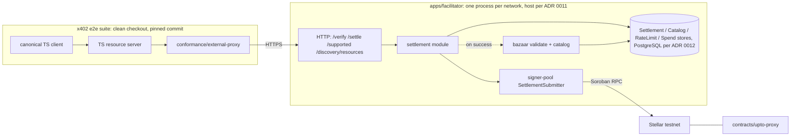
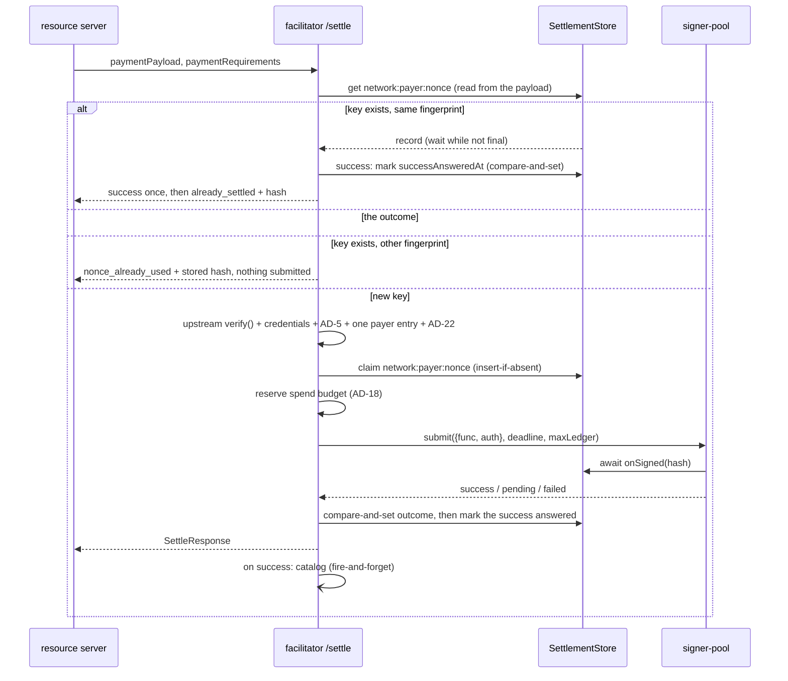

# Architecture Spine: stellar-x402 Milestone 1 (Tranche 1)

## Design Paradigm

**Modular monolith with ports and adapters.**

- **One service.** `apps/facilitator` is the only deployable service and the only composition root. It alone owns HTTP, environment and secrets, store adapters, rate limiting and wiring.
- **Libraries.** `packages/*` take their dependencies through constructors and hold no I/O policy of their own.
- **Contracts.** `contracts/` is a separate Cargo workspace, reached only through Soroban RPC.

| Layer               | Lives in                                                     | Owns                                                                                                   |
| ------------------- | ------------------------------------------------------------ | ------------------------------------------------------------------------------------------------------ |
| Adapters (inbound)  | `apps/facilitator/src/http/`                                 | x402 v2 routes, request validation, rate limiting, harness endpoints                                   |
| Application         | `apps/facilitator/src/`                                      | verify/settle orchestration, the settlement record lifecycle, spend budgets, cataloging trigger, ports |
| Adapters (outbound) | `apps/facilitator/src/adapters/`                             | store implementations (ADR 0012), signer, RPC, metrics                                                 |
| Domain libraries    | `packages/signer-pool`, `packages/bazaar`, `packages/config` | settlement submission, catalog validation and normalization, network constants                         |
| On-chain            | `contracts/upto-proxy`                                       | `upto` settlement contract                                                                             |

## Invariants & Rules

```mermaid
graph TD
  facilitator[apps/facilitator] --> signerpool[packages/signer-pool]
  facilitator --> bazaar[packages/bazaar]
  facilitator --> config[packages/config]
  facilitator --> x402[@x402/stellar + @x402/core + @x402/extensions]
  signerpool --> sdk[@stellar/stellar-sdk 16.x]
  bazaar --> config
  bazaar --> x402
  conformance[conformance] --> config
  x402 --> sdk
```

### AD-1: Dependency direction [ADOPTED]

- **Binds:** all workspace packages
- **Prevents:** libraries that read env or storage on their own, and import cycles.
- **Rule:**
  - Dependencies only point in the direction of the graph above.
  - `packages/*` never import from `apps/*`, never read `process.env`, and never open a store or socket that wasn't passed to them.
  - `packages/config` is the leaf.

### AD-2: One payment = one transaction through the channel pool [ADOPTED]

- **Binds:** T1-facilitator, T1-channel-pool, T1-upto-prototype (ADR 0003)
- **Prevents:** a second submit path that bypasses the pool's sequence handling, fee policy and confirmation.
- **Rule:**
  - Every settlement is submitted with `SettlementSubmitter.submit()` from `packages/signer-pool`, in the delegated-bump shape: the channel is the transaction source, the facilitator is the operation source and pays the fee bump.
  - Nothing else in the service calls `sendTransaction`.
  - The `upto` testnet harness (0004) uses the same shape.

### AD-3: Upstream verifies, we settle

- **Binds:** `/verify`, `/settle` for `exact`
- **Prevents:** verification rules drifting from the spec, and upstream's own submit path being used next to the pool.
- **Rule:**
  - **Upstream owns verification.** Auth signature and scope checks, `Address`/`AddressV2` credentials, simulation and the event checks all belong to `@x402/stellar` `ExactStellarScheme.verify()`. We never re-implement them.
  - **Construction.** `ExactStellarScheme` is constructed with the fee values from AD-10.
    - Upstream takes one RPC URL, so there is one scheme per `RPC_URLS` entry (at most 3), and upstream itself is not changed. They share one active URL with `FallbackRpc`, which owns it and serves the pool, the AD-22 ledger read and the fee-stats bid read, so one outage moves them all once (0045 decision 21). A verify call starts on `FallbackRpc`'s active URL and goes on to the next when it throws, answers `unexpected_verify_error` or gives no answer within 10 s. Only a throw or a timeout moves the shared URL; `unexpected_verify_error` is also what one odd payload can produce, so it tries the next URL for that call alone (decision 22). A call moves the active URL only if no other call has moved it since the call began (a switch counter), so a late answer never switches back.
    - **Return to `RPC_URLS[0]`** (`FallbackRpc`'s). While calls are off it, a call that finds 60 s passed starts a probe beside itself, never inside it: `getLatestLedger` on `RPC_URLS[0]` and on the active URL, each within 10 s. Calls return to `RPC_URLS[0]` only if it answers and trails the active URL by at most 2 ledgers; otherwise the next probe is 60 s later. A client's payload never decides it: upstream refuses many payloads (a wrong amount, recipient, asset or operation) before any RPC call, so a dead RPC would "answer" them in a millisecond; a verify call never moves the URL on an answer. A failure doesn't bring it back either: a failure of the last URL moves calls to the next fallback, or, with none left, keeps them where they are and starts a probe at once (0045 decision 26). Nor does a `FallbackRpc` read (pool, ledger or fee-stats) that fails on the active URL and wraps around to `RPC_URLS[0]`: it returns that answer and counts as that URL's failure, since an RPC that answers can still trail (0061). A probe started at once waits 5 s after the last one began, so a URL that keeps failing starts one per 5 s, not one per call. The 60 s count from the moment calls left `RPC_URLS[0]`; a switch between fallbacks doesn't restart them.
    - **Logs**, each with the network and `RPC_URLS[i]#<fingerprint>` names, never URLs: the shared client's `rpc_failover` (warn, `component: "rpc"`, with `by`, the method or caller that saw the failure, `from`, `to` and a URL-free `reason`), `rpc_failback` (info, with the lag) and `rpc_probe_failed` (warn); upstream's `rpc_exhausted` (warn, `component: "verify"`, every URL tried and why). The `verified` log names the URL that answered as `rpc`.
    - **A rejection is never failed over.** `/verify` is read-only and `/settle` checks again, so the reason is cost and one stable answer per payload, not safety. A lagging RPC can answer either way: it can reject a valid payment (a simulation that fails, `…_expiration_too_far`), and it can accept one the first URL would refuse (a nonce already used on chain, a balance spent since its ledger, a revoked SAC authorization). For `exact` the false accept costs little: `/settle` simulates again through `FallbackRpc`, and AD-6 refuses a replay. For `upto` (0015) `/verify`'s answer carries more weight, so it must not rely on it (threat model).
    - **Steering.** A client can't choose its own verdict by failing over, but it can push everyone's calls to a fallback: exhaust `RPC_URLS[0]`'s per-key quota until it answers 429 (upstream: `unexpected_verify_error`) and every call moves. Until a rate limit (0023), the probe bounds this: calls return once `RPC_URLS[0]` answers the probe, and no payload can keep them away (threat model).
    - With fee-stats bids (AD-10), the bid is read once per call, before any URL's 10 s starts and before the call reads the active URL, and each bid gets one scheme per URL. A bid read that waits out a hung URL moves the shared URL, so the verify call starts on the next one.
    - Upstream's deadline is 10 s per URL, plus, with fee-stats bids, the bid read before them (`FallbackRpc` bounds it at 10 s per URL), plus 1 s, so the last URL's own deadline fires first: 21 s with two URLs and a fixed bid, 41 s with fee-stats, 61 s with three URLs and fee-stats. It is not `/verify`'s whole time: the AD-22 ledger read after it can add `FallbackRpc`'s 10 s per URL. With the shared URL a hung `RPC_URLS[0]` costs one of these waits, not one per client, so the first `/settle` fits its budget (ADR 0011); calls already waiting on it when it is moved still wait their own 10 s.
    - A call cut off by its 10 s keeps running, since upstream's clients can't be cancelled. `main()` sets undici's global header and body timeouts to 10 s, which stellar-sdk's `fetch` uses, so the abandoned request ends instead of holding its socket for undici's default 300 s.
    - Upstream's Horizon read of the ledger close time has no URL of ours to fail over to. It falls back to upstream's default on an error. Upstream reads it after its RPC calls, so a Horizon that hangs takes the URL being tried past its 10 s, which counts as that URL's timeout and moves the shared URL: `rpc_failover` with `by: "verify"` blames an RPC URL for Horizon's delay. With healthy RPCs the probe that the last URL's timeout starts brings calls back (`rpc_failback`), so while Horizon hangs the two lines repeat. Every URL times out, `rpc_exhausted` lists them, and the answer is a 500 with the `UpstreamTimeoutError` of the first URL tried, the active one, not always `RPC_URLS[0]`. Payments are unaffected: the pool's reads and sends answer on either URL.
  - **`/verify`** = upstream `verify()`, then address credentials only, the AD-5 channel check, the AD-6 one-payer-entry check, then the AD-22 validity check. The first rejection returns `isValid: false` with its reason.
    - Address credentials only: an auth entry with source-account credentials would authorize as the operation source, which the pool makes the facilitator. Upstream refuses it too (`…_unsupported_credential_type`); we check it again because the pin `~2.28.0` lets upstream patches float, and the pool refuses such a call as well.
    - A network check runs first: a process serves one network, and upstream would verify another network's payload against that network's default RPC. A V0 envelope is rejected as malformed there too: upstream parses it, but can't assemble its simulation onto it.
    - Upstream answers its own exceptions, such as a failed RPC call, with `unexpected_verify_error`. That is an error of ours, not a verdict on the payment, so `/verify` answers 500. So does every URL failing, by throwing, giving no answer within 10 s or answering `unexpected_verify_error`: upstream's RPC and Horizon clients have no timeout.
    - A request whose `amount` isn't a whole number is a 400: upstream's `BigInt(amount)` would throw, which would be a 500.
    - Upstream's `payer` passes on only as a string. Upstream reads it from the client's `from` before any signature check.
  - **`/settle`** first looks the payload's key up (AD-6): a known settlement is answered from its record, without any check, since a landed payment's nonce is used on chain and upstream's simulation of it fails. A new one gets the same checks again, with the AD-22 floor of the pool (see AD-22), within the settle budget (ADR 0011). It then claims the record (AD-6), builds `{func, auth}` from the client's payload and submits it as in AD-2. The pool's `checkSimulation` hook enforces the spec's balance-change check.
  - Upstream's `ExactStellarScheme.settle()` is never called.

### AD-4: Channel accounts count as the facilitator

- **Binds:** T1-facilitator, T1-channel-pool, T1-upto-prototype
- **Prevents:** a different transaction shape per scheme, or a fallback to facilitator-sourced transactions.
- **Rule:**
  - Channel accounts controlled by the facilitator key satisfy "facilitator as source" in `scheme_exact_stellar.md`.
  - This reading is recorded in [ADR 0005](../adr/0005-channel-accounts-as-facilitator-source.md).
  - Proposing it upstream is deferred.

### AD-5: Payloads must not touch our channel accounts

- **Binds:** `/verify`, `/settle`
- **Prevents:** a crafted payload spending or authorizing through a channel account. Upstream `verify()` only knows our signer addresses, not the channels.
- **Rule:**
  - A payload is rejected when a channel address appears as the transaction source, an operation source, `from`, or the address of any auth entry. Both `Address` and `AddressV2` credentials are checked.
  - The check runs in `/verify` and again in `/settle`.

### AD-6: Claim, dedupe and replay of a settlement

- **Binds:** `/settle`, `SettlementStore`
- **Prevents:**
  - double submission
  - paying N−1 fees for N parallel calls
  - one payment being replayed to unlock another merchant's resource
  - one payment unlocking the same resource more than once
- **Rule:**
  - **Key.** The settlement key is `network:payer:nonce`. The nonce is the int64 nonce of the payer's auth entry, held as a decimal string. A payload must carry exactly one payer auth entry, otherwise the `/verify` checks reject it, at `/verify` and `/settle` alike (upstream de-duplicates signers and doesn't count entries).
  - **Fingerprint.** Each record stores a fingerprint: a hash of the canonical payload plus `paymentRequirements`.
  - **Known key first.** `/settle` reads the key from the payload and looks it up before any check. A known key is a repeat; only a new key is checked and claimed.
  - **Claim.** After verification and before `submit()`, `/settle` claims the key with an atomic insert-if-absent. Only the caller that wins the claim submits.
  - **Repeat with the same fingerprint.** A repeat `/settle` answers from the record.
    - A signed record that isn't final yet: it waits up to `SETTLE_TIMEOUT_MS` for the final outcome, counted from when the repeat first sees the hash.
    - A record with no hash: it waits until the first call's budget ends, counted from the first call's start (before its checks). Then it ends the record itself (`claimed → rejected`, `…_timeout`), so the answer is never `…_timeout` for something that is then sent. If the store can't end it, the answer is `settlement_pending` with no hash.
    - Neither wait goes past the repeat's own budget. A repeat whose budget ends before the first call's (it lost the claim, so it began first) answers `settlement_pending` with no hash and leaves the record to the first call, which may still reserve or sign.
  - **Success once.** `success: true` is answered once per record, by compare-and-set on `successAnsweredAt`. Every later call gets `success: false`, `settle_exact_stellar_already_settled` and the hash. `settlement_pending` doesn't count: the canonical resource server's one retry after it still gets the success. A call whose client left before the mark marks nothing. The costs: a seller that lost our `success` answer can't get it again, and the success goes to whichever call marked first, whoever holds the payment header. A store that can't mark still gets the success, once per process ([ADR 0006](../adr/0006-settlement-record.md)).
  - **Repeat with a different fingerprint.** Rejected with `success: false`, `settle_exact_stellar_nonce_already_used` and the stored hash, if any, so a payment that landed can be reconciled. Nothing is submitted, and the stored outcome is never returned.
  - **Wire shape.** `SubmitStatus` maps as follows:
    - Every answer carries `network` and `payer`.
    - `success` → `{success: true, transaction}`, once; later `{success: false, errorReason: "settle_exact_stellar_already_settled", transaction}`
    - `pending` → `{success: false, errorReason: "settlement_pending", transaction}`
    - `failed` / `rejected` / `expired` → `{success: false, errorReason, transaction}`, with the record's last hash
    - Each thrown submitter error class maps to a fixed `errorReason`, listed with the code.
  - **Deadline.** The submit `deadline` is the call's start plus the shorter of the settle budget and the ledgers left before the auth expiry, at the estimated ledger time.

### AD-7: State goes through ports the facilitator owns

- **Binds:** T1-facilitator, T1-bazaar-foundation
- **Prevents:** packages or handlers talking to a database directly, and rework when 0013 picks the store.
- **Rule:**
  - All state goes through four interfaces defined in `apps/facilitator`: `SettlementStore`, `CatalogStore`, `RateLimitStore` and `SpendStore`.
  - Concrete adapters live in `apps/facilitator/src/adapters/`, and there is an in-memory fake of each for tests.
  - The backing store is one PostgreSQL database per network, in a container on the facilitator's server ([ADR 0012](../adr/0012-facilitator-state-store.md), task 0013). It must support:
    - the atomic claim (AD-6)
    - lookup by any of a settlement's hashes (AD-16)
    - the channel lease (AD-17)
    - the catalog key and the `resources` filters (AD-19, AD-20)

### AD-8: Cataloging never blocks settle

- **Binds:** T1-bazaar-foundation, `/settle`
- **Prevents:** a Bazaar bug failing, delaying or changing a payment.
- **Rule:**
  - **Trigger.** Cataloging starts when a settlement's record turns `success`. That covers both an immediate success and a later `resolved` success.
  - **Ordering.** The store write runs after the response, fire-and-forget. Its errors are logged and counted, never returned to the caller.
  - **Response header.** Only the pure, synchronous AD-19 validation may run before responding. It sets a best-effort `EXTENSION-RESPONSES` header (`processing` or `rejected`). It never changes the response body or status.

### AD-9: Any SEP-41 token, no allowlist

- **Binds:** `/verify`, `/settle`, `/supported`
- **Prevents:** per-token code paths and an asset list in config.
- **Rule:**
  - Verification doesn't depend on the token: the asset comes from `paymentRequirements`, and the simulated balance changes are checked.
  - The test matrix covers testnet USDC, a self-issued SAC and a non-SAC SEP-41 token.
  - Abuse through junk tokens is contained by AD-18, not by an allowlist.

### AD-10: The facilitator pays fees from one fee configuration [ADOPTED]

- **Binds:** `/verify`, `/settle`, signer-pool and `ExactStellarScheme` configuration
- **Prevents:**
  - clients setting our fee
  - verify and settle using different fee ceilings
  - unbounded fee spend
- **Rule:**
  - **Fee.** It is the simulation resource fee plus our inclusion bid (at least 100 stroops), paid twice under the fee bump (below). The client's fee is never used.
  - **The bid counts twice.** The pool settles under a fee bump, where the inner operation and the bump each pay the bid (CAP-15). So the total is the resource fee plus twice the bid, and upstream's `inclusionFeeStroops` is twice the bid, or `/verify` accepts payments the pool refuses. Twice the bid, or twice the fee-stats floor without a fixed bid, must stay below `maxFeeStroops`.
  - **One config value per setting:**
    - `maxFeeStroops` feeds both the upstream `maxTransactionFeeStroops` and the pool's `maxFeeStroops`.
    - `inclusionFeeStroops` feeds both components.
  - **Escalation.** `feeEscalation` is set by the app. T1 uses interim testnet values from config; the mainnet values come from task 0010.

### AD-11: Rate limiting

- **Binds:** inbound HTTP adapter
- **Prevents:** one caller exhausting the pool or our fee budget, and limits implemented differently per route.
- **Rule:**
  - One middleware, with separate budgets for `/verify`, `/settle` and `/discovery/*`. Exceeding a budget returns HTTP 429.
  - **Client IP.** It comes only from the header the edge sets, named by `CLIENT_IP_HEADER` (`CF-Connecting-IP` behind Cloudflare Tunnel, ADR 0011), never from `X-Forwarded-For`. An IPv6 client is counted per /56.
  - **API key.** An optional per-caller API key as an alternative limiter key is not built in T1 (task 0060): without a registry of issued keys, a caller's own key would bypass the limit.
  - **Storage.** Counters go through `RateLimitStore`.
  - **Payer, recipient and asset.** Limits on these are AD-18's job, not the IP limiter's.

### AD-12: One facilitator key per network; channels are hardened

- **Binds:** configuration, `TransactionSigner`, startup
- **Prevents:** key sprawl, keys shared between networks, and channels another key can move.
- **Rule:**
  - **Key.** Each network has one facilitator key. It signs for the channels and pays fee bumps, and it reaches the pool only as a `TransactionSigner`, so the OpenBao Transit signer can replace it ([ADR 0013](../adr/0013-facilitator-key-custody.md), task 0036).
  - **Config.** `FACILITATOR_SECRET`, or in `openbao` mode the Transit key, its version and the fee account's address (ADR 0013), plus `CHANNELS` (addresses, never secrets).
  - **Startup check.** The service refuses to start unless every channel has its master key weight at 0 and the facilitator key as its only signer (`checkChannel`).
  - **Separation.** Testnet and mainnet never share a key or a channel.

### AD-13: Wire protocol is x402 v2 only [ADOPTED]

- **Binds:** all facilitator routes
- **Prevents:** half-supported v1 paths and response shapes drifting from `@x402/core`.
- **Rule:**
  - Request and response bodies are `@x402/core` v2 types.
  - **`/supported`** lists:
    - `kinds`: `exact` on `stellar:testnet` with `extra.areFeesSponsored: true`
    - `extensions`: `bazaar`
    - `signers`: the facilitator key's address only, never the channels
  - `upto` is not advertised until its `/settle` wiring exists (post-T1).

### AD-14: One upstream version

- **Binds:** all workspace `package.json` files
- **Prevents:** two copies of `@x402/core` or `@stellar/stellar-sdk` in one process.
- **Rule:**
  - All `@x402/*` packages share one pinned minor, `~2.28.0` from T1.
  - `@stellar/stellar-sdk` stays on `^16.3.0`. `@x402/stellar` 2.28 requires 16.x, and our code uses the XDR accessor API.
  - A protocol-29 XDR fixture test (`AddressV2`) guards this rule.

### AD-15: The gate runs from our repo against a clean upstream checkout

- **Binds:** T1-e2e-gate, `conformance/`, facilitator HTTP adapter
- **Prevents:**
  - a modified client or harness, which voids the gate
  - unreproducible runs
  - pushing to `x402-foundation/x402` during M1
- **Rule:**
  - **The proxy** lives in `conformance/external-proxy/`. It contains:
    - a `test.config.json` with `name`, `type: facilitator`, `language: typescript`, `protocolFamilies: [stellar]`, `schemes: [exact]`, `x402Versions: [2]`, `extensions: [bazaar]`, and `environment.required` naming our facilitator-URL env var
    - a `run.sh` that listens on `PORT`, prints `Facilitator listening`, answers `GET /health` and `POST /close` itself, and forwards `/verify`, `/settle` and `/supported` to our URL
  - **The run.** A `conformance/` script clones `x402-foundation/x402` read-only at a pinned commit, copies in only that folder, and runs every Stellar `exact` scenario with `--output-json`. A run fails unless every scenario passed with a transaction hash.
  - **The evidence.** Results, including the upstream commit and transaction hashes, are committed to `conformance/results/`.

### AD-16: One owner of the settlement record lifecycle

- **Binds:** `/settle`, the `resolved` event handler, startup
- **Prevents:**
  - a late `resolved` event overwritten by an earlier `pending` write
  - records stuck pending forever after a restart
- **Rule:**
  - **One owner.** A single settlement module in `apps/facilitator` owns every write to `SettlementStore`. Handlers and event listeners call it; they never write to the store themselves.
  - **States.** They only move forward: `claimed → signed → pending → success | failed | rejected | expired`. Each write is a compare-and-set, so a write that would move a record backwards is dropped.
  - **Hashes.** A record keeps every hash it was signed with, because a rebuild produces a new one. It can be found by any of them.
  - **Durable write.** The hash is stored durably before the first send. This requires `signer-pool` to await an async `onSigned` and to abort the send if it rejects; that change to the library is a T1 prerequisite.
  - **Startup.** Before accepting traffic, the module re-checks every non-final record on chain by its hashes and finalizes it.

### AD-17: One process owns a channel set

- **Binds:** deployment, startup, shutdown
- **Prevents:** two processes using one channel's sequence numbers, for example during a rolling deploy.
- **Rule:**
  - **Lease.** At startup a process takes an exclusive lease on its network's channel set through the store and keeps renewing it. Without the lease it doesn't serve `/settle`.
  - **Deploys.** They stop the old process before the new one takes the lease.
  - **Shutdown.** The process stops accepting `/settle`, waits until every in-flight submission is final or recorded as pending, then releases the lease.

### AD-18: Spend budgets contain fee abuse

- **Binds:** `/settle`, `SpendStore`, alerts
- **Prevents:** someone draining the facilitator's XLM through valid self-payments or junk tokens, which IP limits can't stop.
- **Rule:**
  - **Budgets.** Before `submit()`, `/settle` checks and reserves the fee against:
    - a global rolling fee budget
    - per-payer, per-`payTo` and per-asset budgets
  - **Over budget.** Returns `success: false` and submits nothing.
  - **Circuit breaker.** A breaker per asset and per `payTo` opens after repeated on-chain failures.
  - **Alerts.** These raise alerts:
    - the budget nearing its limit
    - an open breaker
    - a low facilitator balance (`checkFacilitatorBalance`)
    - quarantined channels
    - pending results

### AD-19: Catalog integrity

- **Binds:** T1-bazaar-foundation, `packages/bazaar`
- **Prevents:**
  - a parallel Bazaar schema
  - duplicate entries for one route
  - SSRF through seller URLs
  - listings without a payment behind them
- **Rule:**
  - **Trigger.** A resource is cataloged only when its settlement succeeded and the client's payload carries `extensions.bazaar`. Nothing else is indexed.
  - **Types and validator.**
    - Types come from `@x402/extensions` (bazaar). `packages/bazaar` holds only a pure validator and normalizer.
    - The validator accepts both `http` and `mcp` input types.
    - Required fields that are malformed reject the listing. Optional fields that are malformed (`serviceName`, `tags`, `iconUrl`) are dropped.
  - **`iconUrl`.** It must be absolute https, with no IP literals and no loopback or private hosts. The facilitator never fetches any seller-supplied URL in T1.
  - **Resource URLs.** A scheme allowlist by listing type (`http`: `https`, `http`; `mcp`: also `mcp`), no host rules on `http(s)` hosts, and a DNS-style name for an `mcp:` host; SSRF is checked by whoever fetches them (task 0053, ADR 0008). An empty `description` or `mimeType` counts as absent.
  - **Catalog key.** It is `network + payTo + method + normalized resource URL` (with `routeTemplate` applied).
  - **Upserts.** They are idempotent and update `lastUpdated`.

### AD-20: Discovery resources contract

- **Binds:** `GET /discovery/resources`, `CatalogStore`
- **Prevents:** a response shape that differs from the x402 discovery ecosystem.
- **Rule:**
  - The response uses the upstream discovery list types.
  - Filters: `type`, `payTo`, `network`, `extensions`, `limit`, `offset`.
  - `limit` is bounded, with a fixed default.
  - No ranking in T1.

### AD-21: Non-custodial [ADOPTED]

- **Binds:** all
- **Prevents:** the facilitator becoming a holder of client funds.
- **Rule:**
  - The facilitator never takes custody of client or seller funds and never extends credit (ADR-R6).
  - Its accounts hold only XLM for fees and channel reserves.

### AD-22: Minimum remaining validity

- **Binds:** `/verify`, `/settle`, signer-pool
- **Prevents:** paying the fee for a transaction whose authorization expires before it can land.
- **Rule:**
  - A payload whose auth expiration ledger is less than `minValidityLedgers` ahead of the current ledger is rejected.
  - The transaction never stays valid past the auth expiry. `signer-pool`'s `maxLedger` submit option (task 0016) sets the expiry ledger as the envelope's ledger bound, next to its time bound.
  - `signer-pool` keeps one spare ledger: it refuses, after simulation, a call that could land only in the ledger after the one simulated. So `minValidityLedgers` must be at least 2 plus the expected wait for a channel, or a payload `/verify` accepts can fail at `/settle` with `LedgerBoundError` after a simulation.
  - `minValidityLedgers` must also stay well below the client's signing window. Upstream's client signs its auth to expire ⌈`maxTimeoutSeconds` / ledger time⌉ ledgers after signing, with the ledger time from Horizon (5 s when Horizon doesn't answer): about 12 ledgers at the usual 60 s. Ledgers usually pass before `/verify`. So a minimum of 12 rejects nearly every payment; the default is 4: 2 for the pool plus about 2 of channel wait.
  - So a resource needs a `maxTimeoutSeconds` well above `minValidityLedgers × 5` seconds, 20 s at the default. Near that bound, most payments are rejected as too soon. When ⌈`maxTimeoutSeconds` / 5⌉ is at most the minimum, the reason says so.
  - `/settle` rechecks the expiry at the pool's floor of 2 ledgers, not at `minValidityLedgers`: a payload `/verify` accepted has used part of its margin by then, and the pool refuses only below 2.

## Consistency Conventions

| Concern               | Convention                                                                                                                                                                                           |
| --------------------- | ---------------------------------------------------------------------------------------------------------------------------------------------------------------------------------------------------- |
| Files and modules     | kebab-case file names; ESM with `.js` suffixes on local imports                                                                                                                                      |
| Errors in libraries   | typed `Error` subclasses with `override readonly name`; never thrown strings                                                                                                                         |
| HTTP status           | verify and settle outcomes are x402 bodies (`isValid` / `success` with a reason) with status 200; 400 for malformed requests, 429 for rate limits, 500 for unexpected errors                         |
| Amounts               | `bigint` in code (token base units, fees in stroops); decimal strings on the wire; `bigint` stroops in the store, other amounts as strings in `jsonb`                                                |
| Identifiers           | networks as CAIP-2 strings from `packages/config`; transaction hashes as 64-character lowercase hex; settlement key as in AD-6                                                                       |
| Config                | read and validated once at startup in `apps/facilitator` (zod); passed down through constructors. RPC URLs come from config, a fallback list is allowed, and public testnet RPC is acceptable for T1 |
| Time and I/O in tests | `rpc`, `now` and `sleep` injected; store ports faked in memory                                                                                                                                       |
| Logging and metrics   | structured, one event per line, carrying `network`, settlement key and the transaction hash where known; secrets and full XDR are never logged; pool `onEvent` forwarded to metrics                  |
| HTTP hardening        | request body size limit; no CORS on `/verify` and `/settle`; client IP header set from config                                                                                                        |
| Testing               | unit tests with fakes in each package; facilitator integration tests against in-memory stores and `fake-rpc`; testnet runs (AD-9 token matrix, AD-15 gate) record their transaction hashes           |
| Test helpers          | a package shares its fakes through a `<package>/testing` subpath (e.g. `@stellar-x402/signer-pool/testing`); a lint rule keeps `src` from importing any of them                                      |

## Stack

| Name                                        | Version                                                            |
| ------------------------------------------- | ------------------------------------------------------------------ |
| Node.js                                     | >=22.12 (22 LTS, maintenance until 2027-04; CI also runs 24)       |
| pnpm                                        | 11.5.2                                                             |
| TypeScript                                  | ~6.0.3 (ESM, NodeNext, strict; staying on 6.x in T1 is deliberate) |
| @x402/core, @x402/stellar, @x402/extensions | ~2.28.0                                                            |
| @stellar/stellar-sdk                        | ^16.3.0                                                            |
| express                                     | ^5.2.1                                                             |
| zod                                         | ^3.25.76 (to be added to `apps/facilitator`)                       |
| vitest                                      | ^5.0.2                                                             |
| x402 protocol                               | v2                                                                 |
| soroban-sdk / Rust / stellar-cli            | 28.0.0 / 1.97.1 / 28.1.0                                           |
| Network                                     | Stellar testnet (`stellar:testnet`), protocol 29                   |

## Structural Seed





```text
apps/facilitator/src/
  http/         # routes, validation, rate limiting, body limits
  settlement/   # verify + settle orchestration, record lifecycle, spend budgets
  ports/        # SettlementStore, CatalogStore, RateLimitStore, SpendStore
  adapters/     # store, signer, metrics implementations
conformance/
  external-proxy/   # test.config.json, run.sh, proxy.mjs
  src/              # the gate runner: pinned upstream checkout, result checks
  results/          # committed run outputs with tx hashes
```

## Capability → Architecture Map

| Capability / Area                            | Lives in                                    | Governed by                                      |
| -------------------------------------------- | ------------------------------------------- | ------------------------------------------------ |
| T1-facilitator: verify/settle/supported      | `apps/facilitator`                          | AD-3, AD-5, AD-6, AD-9, AD-13, AD-16, AD-22      |
| T1-facilitator: sponsored fees               | `apps/facilitator` + `signer-pool` config   | AD-10, AD-12, AD-18, AD-21                       |
| T1-facilitator: rate limiting                | `apps/facilitator/src/http`                 | AD-11, AD-18, AD-7                               |
| T1-channel-pool                              | `packages/signer-pool`                      | AD-2, AD-4, AD-12, AD-16, AD-17, AD-22, ADR 0003 |
| T1-bazaar-foundation: resources + cataloging | `packages/bazaar`, `apps/facilitator`       | AD-7, AD-8, AD-19, AD-20                         |
| T1-upto-prototype                            | `contracts/upto-proxy`, tasks 0004 and 0005 | AD-2, AD-4, AD-13 (not advertised)               |
| T1-e2e-gate                                  | `conformance/`                              | AD-15, AD-13, AD-6 (pending wait)                |

## Decision Records

The rationale and rejected alternatives for these ADs are in ADRs:

| ADR                                                           | Covers                             |
| ------------------------------------------------------------- | ---------------------------------- |
| [0003](../adr/0003-settlement-channel-account-pool.md)        | AD-2                               |
| [0004](../adr/0004-facilitator-shape.md)                      | AD-1, AD-3, AD-7, AD-8             |
| [0005](../adr/0005-channel-accounts-as-facilitator-source.md) | AD-4, AD-5, AD-12, AD-13 (signers) |
| [0006](../adr/0006-settlement-record.md)                      | AD-6, AD-16, AD-17, AD-22          |
| [0007](../adr/0007-fee-abuse-containment.md)                  | AD-9, AD-10, AD-11, AD-18, AD-21   |
| [0008](../adr/0008-bazaar-catalog-integrity.md)               | AD-8 (header), AD-19, AD-20        |
| [0009](../adr/0009-conformance-gate-harness.md)               | AD-13, AD-15                       |
| [0011](../adr/0011-facilitator-hosting.md)                    | AD-11, AD-12, AD-15, AD-17         |
| [0012](../adr/0012-facilitator-state-store.md)                | AD-7 (store)                       |
| [0013](../adr/0013-facilitator-key-custody.md)                | AD-12 (key custody)                |

## Deferred

- **State store:** decided in [ADR 0012](../adr/0012-facilitator-state-store.md) (task 0013): one PostgreSQL database for all four ports and Tranche 2 search, run in a container on the Hetzner server (ADR 0011).
- **Hosting, container setup, key custody, logger, metrics and alert backend:** decided in [ADR 0011](../adr/0011-facilitator-hosting.md) (tasks 0014 and 0039): the company Hetzner server with Docker Compose, the key in OpenBao Transit on the server (ADR 0013), CloudWatch logs, EMF metrics and alarms to Slack. Constraints it meets:
  - the process is long-lived, and scale-to-zero is not allowed
  - the lease and stop-before-start deploys from AD-17 apply
- **Mainnet fee values** (`feeEscalation`, `maxFeeStroops`): task 0010. T1 uses interim testnet values.
- **Numeric budgets and limits** (AD-11, AD-18, AD-22): set in config during the T1 build and recorded with the facilitator task.
- **`upto` settlement in `/settle`:** after T1 (task 0015).
- **Bazaar search and ranking, MCP server, SDK helpers:** later tranches.
- **Mainnet and its RPC provider:** later tranche, as a separate deployment per AD-12.
- **Runtime pool resizing and operations:** task 0011.
- **Batch settlement (B2):** task 0008.
- **Proposing the AD-4 reading upstream:** after T1; nothing is pushed to `x402-foundation/x402` in M1.

## Open Questions

- **`upfront` payment flow (answered 2026-10-15, task 0028):** the resource server calls `/settle` without a `/verify` first, before serving the resource, with `extra.paymentFlow: "upfront"` in the requirements. `/settle` must check the payment itself, as the 0009 settle does.
- **Backlog alignment (done 2026-10-07):**
  - 0009 is now T1 `exact` wiring
  - 0015 holds `upto` `/settle`, after T1
  - 0016 holds the signer-pool prerequisites (awaited `onSigned`, `maxLedger`, the XDR fixture)
  - 0004, 0005, 0011, 0013 and 0014 are updated
  - the stories for the rest of T1 are in `docs/planning/m1-epics.md` (tasks 0017–0032)
