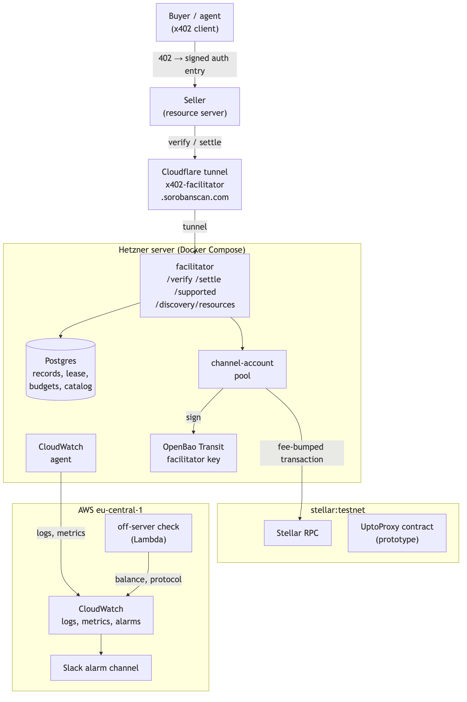
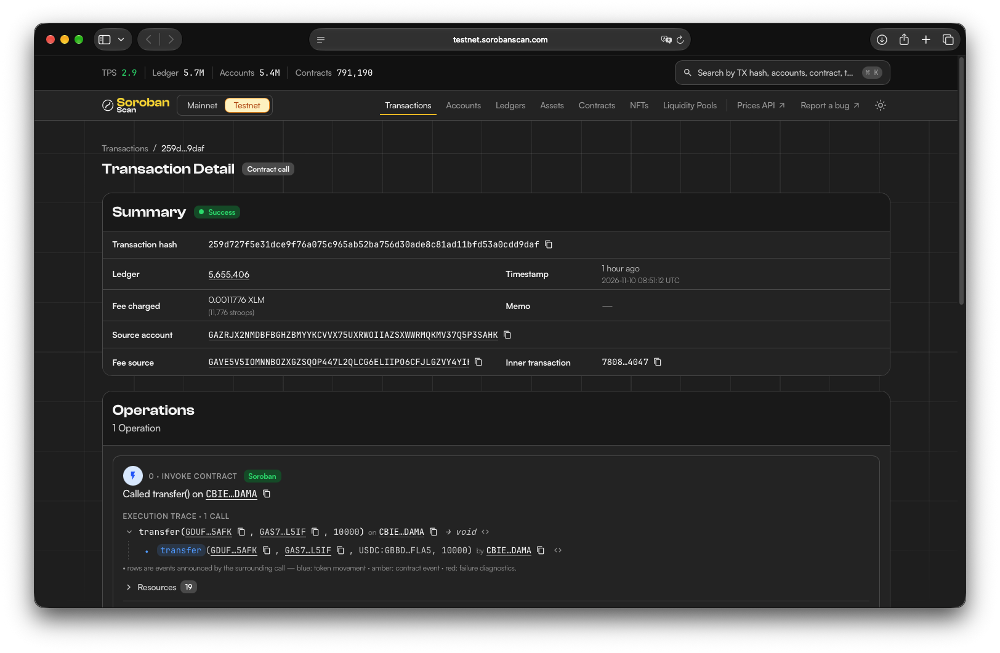
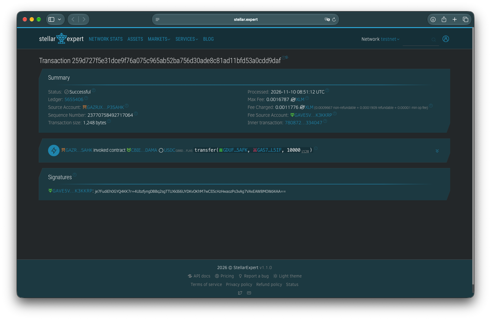
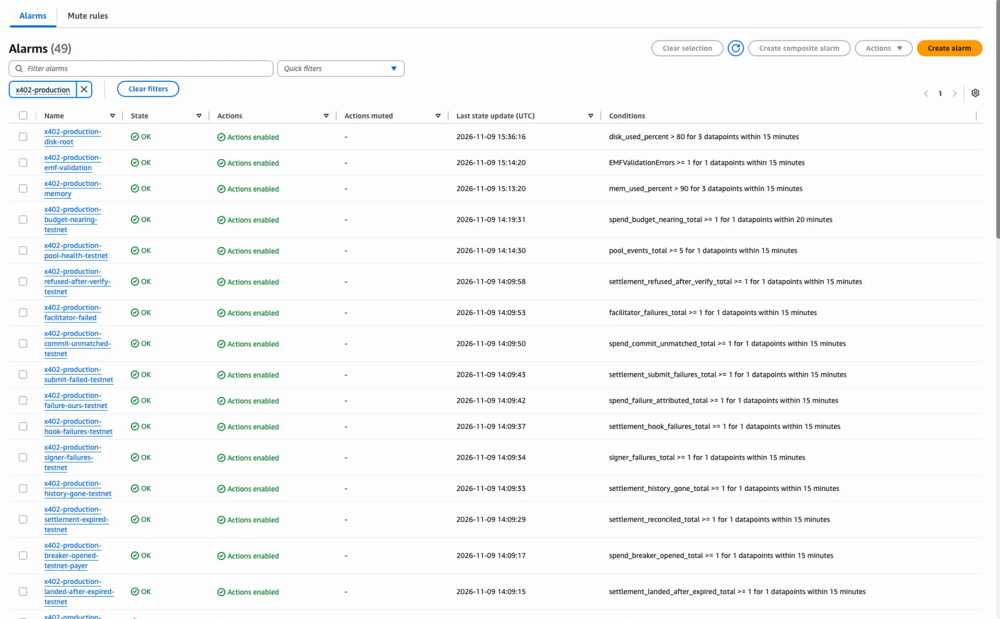
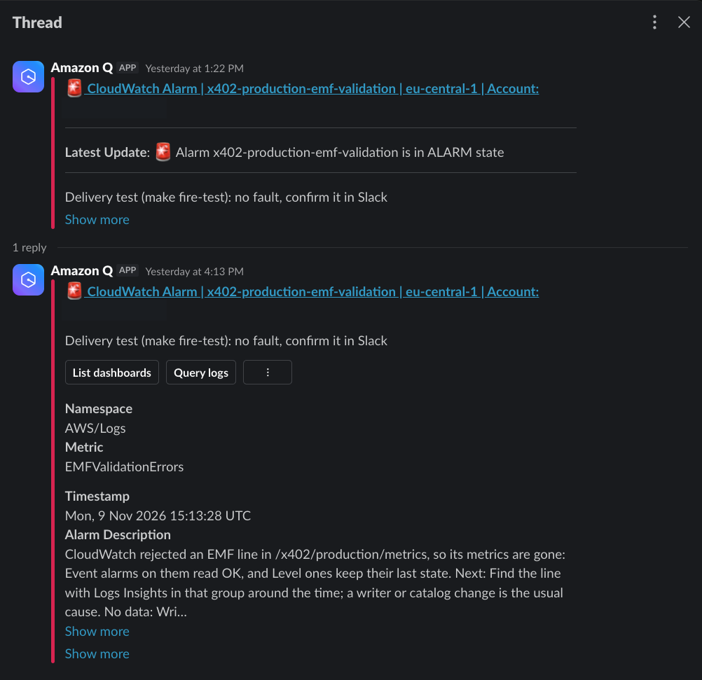

---
margin:
  x: 1.5cm
  y: 1.5cm
---

# Stellar x402 Facilitator with Bazaar — Milestone 1 Deliverable Evidence

> - **Project:** x402 Facilitator with Bazaar discovery support for Stellar (SCF RFP track,
>   RFP 7)
> - **Team:** Rumble Fish
> - **Milestone:** 1 (Tranche 1) — testnet facilitator, channel-account pool, Bazaar foundation,
>   `upto` design and prototype, conformance gate
>
> This document is the written companion to the Milestone 1 submission video. It maps every
> Tranche 1 deliverable to evidence a reviewer can check: commands against the live testnet
> service, their output, settled transaction hashes, screenshots and code references.
>
> It also states what Milestone 1 deliberately does not claim (mainnet, search, the MCP server and
> the rest of the later tranches), so that nothing here is read as more than it is.

## Table of contents

1. [Executive summary](#1-executive-summary)
2. [Deliverable definition](#2-deliverable-definition)
3. [Architecture](#3-architecture)
4. [Scope against the RFP and the proposal](#4-scope-against-the-rfp-and-the-proposal)
5. [Deliverable evidence](#5-deliverable-evidence)
6. [The production service behind the testnet deployment](#6-the-production-service-behind-the-testnet-deployment)
7. [What is deliberately not claimed](#7-what-is-deliberately-not-claimed)
8. [Live endpoints and access](#8-live-endpoints-and-access)
9. [Repository navigation](#9-repository-navigation)

## 1. Executive summary

Milestone 1 — the testnet foundation of the facilitator and its Bazaar — is complete and running
on `stellar:testnet` at `https://x402-facilitator.sorobanscan.com`. Every Tranche #1 line item is
delivered as approved; none was dropped or moved.

The facilitator serves `/verify`, `/settle` and `/supported` per the x402 v2 spec, built on the
Apache-2.0 `@x402/stellar` package, for any SEP-41 token. It sponsors network fees, so a buyer
holds only the payment asset, and it limits requests per client IP and fee spending by rolling
budgets. Every settlement goes through a pool of channel accounts, reimplemented under
Apache-2.0, so concurrent payments don't wait on one account's sequence number. The Bazaar's
`GET /discovery/resources` lists resources cataloged automatically when a payment carrying the
`bazaar` extension settles. The `upto` scheme's design is final, its proxy contract runs on
testnet, and its specification is already proposed upstream.

The Tranche #1 conformance bar is met. In the final rerun on the deployed Tranche 1 build
(2026-11-10, facilitator commit `5d2e26ba`), the x402 Foundation's own end-to-end suite,
unmodified, completed 18 of 18 `exact` payments against our public facilitator through the
suite's external facilitator proxy, and the gate recorded and checked 18 settled testnet
transactions ([`conformance/REPORT.md`](../../conformance/REPORT.md)).

The dependency tree's licenses were re-audited at this tranche boundary: no AGPL, GPL, SSPL or
LGPL-only dependency in 291 npm packages and 239 Rust crates
([`milestone-1-license-audit.md`](./milestone-1-license-audit.md)).

Tranche #1 is testnet only. Mainnet, search and ranking, the MCP server, SDK helpers and `upto` in
`/settle` are later tranches of the approved plan ([section 4](#4-scope-against-the-rfp-and-the-proposal));
[section 7](#7-what-is-deliberately-not-claimed) states plainly what is not claimed.

## 2. Deliverable definition

Quoted from our response to the Panel Review (feedback of 2026-09-16): the Tranche #1 line items
of its budget (§1), and the conformance bar it sets for Tranche #1 sign-off (§4).

> **Tranche #1 (Milestone 1)**
>
> - Facilitator hardening on testnet (verify/settle/supported, any SEP-41 token, sponsored fees,
>   rate limiting)
> - Channel-account pool, permissively-licensed reimplementation (sequence-number throughput —
>   see §5)
> - **Bazaar discovery layer, foundation** (`resources` endpoint + cataloging pipeline, no ranking
>   yet)
> - `upto` scheme design finalization + testnet proxy-contract prototype
>
> **Tranche #1 conformance bar:** **an unmodified canonical client from the `x402-foundation/x402`
> reference repo's own end-to-end test suite** completes verify → settle against our testnet
> facilitator for the `exact` scheme, at the wire level, with a **real settled transaction hash**
> produced and recorded — not a client we've adapted or reimplemented ourselves.

The same response commits to re-auditing the full dependency tree's licenses at each tranche
boundary (§5). Acceptance criteria per line item are in the Tranche 1 stories of
[`docs/planning/m1-epics.md`](../planning/m1-epics.md); the architecture they build against is
[`docs/architecture/m1-spine.md`](../architecture/m1-spine.md).

| #   | Deliverable                      | RFP 7                                                                     | Proposal           | Evidence                                               |
| --- | -------------------------------- | ------------------------------------------------------------------------- | ------------------ | ------------------------------------------------------ |
| D1  | Facilitator hardening on testnet | Facilitator: verify/settle/supported, SEP-41, sponsored fees, rate limits | §3.1, §3.1.1, §3.2 | [5.1](#51-d1--hardened-facilitator-on-testnet)         |
| D2  | Channel-account pool             | Stellar-specific: channel accounts for sequence bottlenecks               | §3.3               | [5.2](#52-d2--channel-account-pool-in-the-settle-path) |
| D3  | Bazaar foundation                | `GET /discovery/resources` with filters, automatic cataloging             | §4.1, §4.2, §4.4   | [5.3](#53-d3--bazaar-foundation)                       |
| D4  | `upto` design and prototype      | Settlement schemes: `upto`, `scheme_upto_stellar.md`                      | §6.1–§6.3          | [5.4](#54-d4--upto-final-design-and-testnet-prototype) |
| D5  | Conformance bar                  | Conformance at wire level with unmodified canonical clients               | §9                 | [5.5](#55-d5--conformance-gate)                        |

## 3. Architecture

{height=20cm}

- **One facilitator service** (`apps/facilitator`) serves `/verify`, `/settle`, `/supported` and
  `/discovery/resources`, as the proposal's §2 has it. It builds on the Apache-2.0
  `@x402/stellar` for verify and settle, as the RFP asks, and adds the checks of
  [ADR 0004](../adr/0004-facilitator-shape.md).
- **Settlement** goes through a pool of channel accounts (`packages/signer-pool`), each
  transaction fee-bumped by the facilitator's fee account, so the buyer pays no XLM.
- **The facilitator key** is held in OpenBao Transit on the server and reached over a unix
  socket; the raw key never enters the facilitator's process
  ([ADR 0013](../adr/0013-facilitator-key-custody.md)).
- **State** — settlement records, the channel lease, spend budgets, the catalog — is in Postgres
  ([ADR 0012](../adr/0012-facilitator-state-store.md)).
- **Hosting:** a Hetzner server with Docker Compose behind a Cloudflare tunnel, deployed by digest
  from CI ([ADR 0011](../adr/0011-facilitator-hosting.md)). Logs, metrics and alarms go to
  CloudWatch, alarms to the team's Slack channel ([`docs/monitoring.md`](../monitoring.md)).

## 4. Scope against the RFP and the proposal

The RFP's full scope spans the grant; Tranche #1 is its testnet foundation. The rest is allocated
to later tranches in the Panel Review response's budget (§1), and Tranche #1 delivers no less
than its line items:

| RFP / proposal item                                                         | Tranche (Panel Review response §1)                                                                              |
| --------------------------------------------------------------------------- | --------------------------------------------------------------------------------------------------------------- |
| Bazaar search + ranking engine, its nDCG@10 evaluation                      | #2                                                                                                              |
| MCP discovery server (search + paid-call tools)                             | #2                                                                                                              |
| `scheme_upto_stellar.md` finalized and submitted to the TSC; upstream merge | #2, #3 — submitted early: [x402-foundation/x402#3781](https://github.com/x402-foundation/x402/pull/3781) (open) |
| SDK helpers (TypeScript, Rust seller crate)                                 | #2, #3                                                                                                          |
| Security audit engagement and remediation (audit via SCF Audit Bank)        | #2, #3                                                                                                          |
| Conformance test suite and report                                           | #3 — the Tranche #1 bar (D5) is met now                                                                         |
| Example integrations                                                        | #3                                                                                                              |
| Production readiness: runbook, monitoring, mainnet launch                   | #3 — runbook and monitoring already run the testnet service (section 6)                                         |

**Refinements against the proposal.** Every Tranche #1 line item is delivered; where how it works
differs from the proposal's technical architecture, a recorded decision says why:

| Proposal                                                                        | Tranche #1                                                                                                                                                                                                       | Decided in                                                                                                                    |
| ------------------------------------------------------------------------------- | ---------------------------------------------------------------------------------------------------------------------------------------------------------------------------------------------------------------- | ----------------------------------------------------------------------------------------------------------------------------- |
| §3.1, §3.2: the facilitator's own account is the transaction's source           | A channel account is the source and the facilitator's fee account pays a fee bump, so settlements don't share one sequence number; a channel's address counts as the facilitator's own in every check (5.1, 5.2) | [ADR 0003](../adr/0003-settlement-channel-account-pool.md), [ADR 0005](../adr/0005-channel-accounts-as-facilitator-source.md) |
| §4.1: the payment's echo of the `bazaar` extension is what gets cataloged       | The echo starts cataloging; the listing holds what the seller's own 402 says, asked with one unpaid request, so another payer can't overwrite or pad it (5.3)                                                    | [ADR 0008](../adr/0008-bazaar-catalog-integrity.md), task 0063                                                                |
| §4.4: the catalog in a ClickHouse `ReplacingMergeTree`                          | All facilitator state, the catalog included, in PostgreSQL, which Tranche #2's search and ranking are planned on too                                                                                             | [ADR 0012](../adr/0012-facilitator-state-store.md)                                                                            |
| §9: the facilitator's only exposure is the network fee, bounded by verification | Also rolling spend budgets, attributed breakers, a balance floor, and one settlement in flight per payer and asset: one payer settles about one payment per ledger and asset (5.2)                               | [ADR 0007](../adr/0007-fee-abuse-containment.md), task 0024                                                                   |
| RFP: document caller authentication and rate limiting                           | Testnet is free and open, limited per client IP; API keys come with pubnet                                                                                                                                       | [ADR 0007](../adr/0007-fee-abuse-containment.md) (amendment of 2026-11-03), tasks 0105–0108                                   |

## 5. Deliverable evidence

Every command below runs against the public testnet service as written; none needs a key.

```bash
export FAC=https://x402-facilitator.sorobanscan.com
```

### 5.1 D1 — Hardened facilitator on testnet

**Claimed:** `/verify`, `/settle` and `/supported` per the x402 v2 spec on `stellar:testnet`,
for any SEP-41 token, with network fees sponsored by the facilitator and per-IP rate limits.

**The service answers, with fees sponsored:**

```bash
curl -s $FAC/supported | jq
```

```json
{
  "kinds": [
    {
      "x402Version": 2,
      "scheme": "exact",
      "network": "stellar:testnet",
      "extra": { "areFeesSponsored": true }
    }
  ],
  "extensions": ["bazaar"],
  "signers": { "stellar:*": ["GAVE5V5IOMNNBOZXGZSQOP447L2QLCG6ELIIPO6CFJLGZVY4YIK3KKRP"] }
}
```

```bash
curl -s $FAC/health | jq
```

```json
{
  "ready": true,
  "signer": "ok",
  "listed": true,
  "commit": "5d2e26ba141747db0713efd9e4b2dfd1b2510f69"
}
```

Both read on 2026-11-10; the commit is the one the gate's final rerun names (section 5.5).

**Any SEP-41 token, the buyer paying no XLM.** The token matrix
([`token-matrix.ts`](../../apps/facilitator/test/live/token-matrix.ts)) starts the facilitator
from the code it is run on, with channels of its own, and settles one payment each in Circle
testnet USDC, a Stellar Asset Contract (`UPTOE2E`) and a plain SEP-41 (wasm) token, then two
batches of six. It ran on 2026-11-10 from `5d2e26ba`, the commit production runs, with RPC ordered
as production orders it
([`token-matrix-testnet.json`](../../apps/facilitator/test/live/results/token-matrix-testnet.json),
[#172](https://github.com/rumblefishdev/stellar-x402/pull/172)):

| Token           | Transaction                                                                                                                        | Ledger  |
| --------------- | ---------------------------------------------------------------------------------------------------------------------------------- | ------- |
| Circle USDC     | [`71fa8ccb7df5c15c…`](https://stellar.expert/explorer/testnet/tx/71fa8ccb7df5c15c83a95bedf1158470b9f79769b9d891eefed660bf3e14bb3a) | 5656894 |
| SAC (`UPTOE2E`) | [`616ad2ef1426e88f…`](https://stellar.expert/explorer/testnet/tx/616ad2ef1426e88fa3ce150aadbeff60298ffcd007c268dc0bbbd29de6ca6949) | 5656898 |
| SEP-41 (wasm)   | [`216bdc02fb0470fd…`](https://stellar.expert/explorer/testnet/tx/216bdc02fb0470fd131db621d9d4b0345817e6a940324bba0ed3e6af0028c413) | 5656901 |

Its nine checks are all `true`: each token verified, settled and paid the seller the full amount
(`everyTokenSettled`), the facilitator paid every fee (`facilitatorPaidEveryFee`), and the buyer's
XLM balance and sequence number are unchanged (`buyerPaidNoXlm`, `buyerSourcedNothing`). The
batches' checks are D2's (5.2).

**Strict auth-entry validation** (proposal §3.1.1, Panel Review response §5). `/verify` runs
upstream's `verify()`, which protects the facilitator's own address, then refuses source-account
credentials and any payload where a channel address appears as the transaction or operation
source, `from`, or an auth entry's address, for both `Address` and `AddressV2` (CAP-71)
credentials, in `/verify` and again in `/settle`
([ADR 0005](../adr/0005-channel-accounts-as-facilitator-source.md), the non-custodial guarantee).
It also requires exactly one auth entry for the payer, and a validity window between a minimum and
`MAX_VALIDITY_LEDGERS` (66 ledgers by default), with an upstream error answered as a 500 rather
than a verdict ([spine AD-3](../architecture/m1-spine.md)). A smart-wallet (C-address) payer
settles through the network's own authorization flow (`cAccountSettled` in the spend matrix).

The test of each check (permalinks to `develop` at `da93723a`):

| Check                                                                            | Test                                                                                                                                                                                                                                                                                                                                     |
| -------------------------------------------------------------------------------- | ---------------------------------------------------------------------------------------------------------------------------------------------------------------------------------------------------------------------------------------------------------------------------------------------------------------------------------------- |
| The facilitator's own (muxed) address anywhere in the payload is refused         | [`verify.test.ts:387`](https://github.com/rumblefishdev/stellar-x402/blob/da93723ae5ac9cecffd503def406fe4ad6b1d5c7/apps/facilitator/test/verify.test.ts#L387)                                                                                                                                                                            |
| A source-account auth entry is refused, even when upstream accepts it            | [`verify.test.ts:240`](https://github.com/rumblefishdev/stellar-x402/blob/da93723ae5ac9cecffd503def406fe4ad6b1d5c7/apps/facilitator/test/verify.test.ts#L240)                                                                                                                                                                            |
| A channel as the transaction source                                              | [`verify.test.ts:342`](https://github.com/rumblefishdev/stellar-x402/blob/da93723ae5ac9cecffd503def406fe4ad6b1d5c7/apps/facilitator/test/verify.test.ts#L342)                                                                                                                                                                            |
| A channel as the operation source                                                | [`verify.test.ts:357`](https://github.com/rumblefishdev/stellar-x402/blob/da93723ae5ac9cecffd503def406fe4ad6b1d5c7/apps/facilitator/test/verify.test.ts#L357)                                                                                                                                                                            |
| A channel as `from`                                                              | [`verify.test.ts:364`](https://github.com/rumblefishdev/stellar-x402/blob/da93723ae5ac9cecffd503def406fe4ad6b1d5c7/apps/facilitator/test/verify.test.ts#L364)                                                                                                                                                                            |
| A channel as an auth entry's address, with `Address` and `AddressV2` credentials | [`verify.test.ts:372`](https://github.com/rumblefishdev/stellar-x402/blob/da93723ae5ac9cecffd503def406fe4ad6b1d5c7/apps/facilitator/test/verify.test.ts#L372)                                                                                                                                                                            |
| The checks run again in `/settle`, which answers a failed one without claiming   | [`settle.test.ts:699`](https://github.com/rumblefishdev/stellar-x402/blob/da93723ae5ac9cecffd503def406fe4ad6b1d5c7/apps/facilitator/test/settle.test.ts#L699)                                                                                                                                                                            |
| Exactly one auth entry, the payer's                                              | [`verify.test.ts:437`](https://github.com/rumblefishdev/stellar-x402/blob/da93723ae5ac9cecffd503def406fe4ad6b1d5c7/apps/facilitator/test/verify.test.ts#L437)                                                                                                                                                                            |
| The minimum validity, with `Address` and `AddressV2` credentials                 | [`verify.test.ts:496`](https://github.com/rumblefishdev/stellar-x402/blob/da93723ae5ac9cecffd503def406fe4ad6b1d5c7/apps/facilitator/test/verify.test.ts#L496)                                                                                                                                                                            |
| The maximum validity (`MAX_VALIDITY_LEDGERS`), with `Address` and `AddressV2`    | [`verify.test.ts:509`](https://github.com/rumblefishdev/stellar-x402/blob/da93723ae5ac9cecffd503def406fe4ad6b1d5c7/apps/facilitator/test/verify.test.ts#L509)                                                                                                                                                                            |
| An error inside upstream is ours, answered 500, not a verdict                    | [`verify.test.ts:149`](https://github.com/rumblefishdev/stellar-x402/blob/da93723ae5ac9cecffd503def406fe4ad6b1d5c7/apps/facilitator/test/verify.test.ts#L149), [`verify-route.test.ts:235`](https://github.com/rumblefishdev/stellar-x402/blob/da93723ae5ac9cecffd503def406fe4ad6b1d5c7/apps/facilitator/test/verify-route.test.ts#L235) |

**CAP-71 `AddressV2` credentials are accepted.** Both validity tests above accept a payment at the
exact bound with `AddressV2` credentials as with `Address` ones. On testnet, the channel pool
settled a payment whose client auth entry is `AddressV2`:
[`b597301aceaceb40…`](https://stellar.expert/explorer/testnet/tx/b597301aceaceb406760fbc54dbcf25007bbb0083af5b71afe0b5a42f7647052)
(ledger 5054851, 2026-10-06, successful), kept as a fixture the tests parse
([`packages/signer-pool/test/xdr-fixture.test.ts`](https://github.com/rumblefishdev/stellar-x402/blob/da93723ae5ac9cecffd503def406fe4ad6b1d5c7/packages/signer-pool/test/xdr-fixture.test.ts#L39)).
The canonical client in the gate (5.5) still signs `Address` credentials: 18 of 18.

**Fee abuse containment and rate limits.** Requests are limited per client IP: 600 a minute on
`/verify` and on `/settle`, 120 on `/discovery/*` (defaults in
[`apps/facilitator/src/config.ts`](../../apps/facilitator/src/config.ts)). Fee spending is capped
by rolling budgets (global, per payer, per `payTo`, per asset) and parties whose settlements keep
failing on chain are cut off by breakers
([ADR 0007](../adr/0007-fee-abuse-containment.md)); the testnet run:
[`spend-matrix-testnet.json`](../../apps/facilitator/test/live/results/spend-matrix-testnet.json).

**Missing trustline** (Panel Review response §5, task 0078). When upstream's simulation fails, the
facilitator looks for the reason, and a missing trustline is answered by name before anything is
sent: `invalid_exact_stellar_payer_trustline_missing` or
`invalid_exact_stellar_payto_trustline_missing`, with a message saying which account lacks the
trustline to which asset and what to do. Tests:
[`verify.test.ts:175`](https://github.com/rumblefishdev/stellar-x402/blob/da93723ae5ac9cecffd503def406fe4ad6b1d5c7/apps/facilitator/test/verify.test.ts#L175)
(the reason replaces upstream's `simulation_failed`),
[`trustline.test.ts:140`](https://github.com/rumblefishdev/stellar-x402/blob/da93723ae5ac9cecffd503def406fe4ad6b1d5c7/apps/facilitator/test/trustline.test.ts#L140)
(the seller's missing trustline, named with what the seller must do),
[`trustline.test.ts:149`](https://github.com/rumblefishdev/stellar-x402/blob/da93723ae5ac9cecffd503def406fe4ad6b1d5c7/apps/facilitator/test/trustline.test.ts#L149)
(the payer's),
[`verify-route.test.ts:105`](https://github.com/rumblefishdev/stellar-x402/blob/da93723ae5ac9cecffd503def406fe4ad6b1d5c7/apps/facilitator/test/verify-route.test.ts#L105)
(the route logs its message). The buyer-side SDK step the response also describes is a later
tranche (SDK helpers).

### 5.2 D2 — Channel-account pool in the settle path

**Claimed:** `/settle` submits through a pool of channel accounts, a permissive reimplementation
under Apache-2.0, so concurrent settlements don't wait on one account's sequence number.

- Design: [ADR 0003](../adr/0003-settlement-channel-account-pool.md) and
  [ADR 0005](../adr/0005-channel-accounts-as-facilitator-source.md); the code:
  [`packages/signer-pool`](../../packages/signer-pool/).
- In every gate settlement (5.5) the transaction's source is a channel account and the fee bump's
  source is the fee account `GAVE5V5I…KKRP`.
- In the token matrix (5.1), one payment from each of six buyers, sent at once, settled through
  four channels, three of them in ledger 5656911 (`spreadSettled`, `batchUsedSeveralChannels`,
  `batchSharedALedgerAcrossChannels`).
- Six payments from one buyer, sent at once, settled one at a time, one per ledger
  (`batchOnePayerOneAtATime`). This is intended: a payer has at most one settlement in flight per
  asset ([ADR 0007](../adr/0007-fee-abuse-containment.md), task 0024), so one balance can't pass
  simulation N times and fail N−1 times on chain at the facilitator's fee. Throughput across
  channels comes from many payers; one payer settles about one payment per ledger and asset.
- One process at a time holds the channel set: a lease with a fencing token, released on a
  graceful shutdown (tasks 0025, 0071).
- The service refuses to start unless every channel's master key weight is 0 and the
  facilitator key is its only signer (ADR 0005).

One gate settlement, row 1 of the table in 5.5: the source account is the channel
`GAZRJX2N…SAHK` (master key weight 0, the facilitator key its only signer), the fee source is the
fee account `GAVE5V5I…KKRP`, and the one operation is a `transfer` of 10000 units (0.001 USDC)
from the buyer `GDUF…5AFK` to the seller `GAS7…L5IF`. The buyer is neither a source nor a fee
payer. In Soroban Scan, Rumble Fish's explorer
([`testnet.sorobanscan.com`](https://testnet.sorobanscan.com/transactions/259d727f5e31dce9f76a075c965ab52ba756d30ade8c81ad11bfd53a0cdd9daf)):

{width=85%}

The same transaction in an independent explorer
([`stellar.expert`](https://stellar.expert/explorer/testnet/tx/259d727f5e31dce9f76a075c965ab52ba756d30ade8c81ad11bfd53a0cdd9daf)):

{width=85%}

**Licensing.** The repository and every package are Apache-2.0, with no AGPL dependency (the RFP's
non-functional requirement). The dependency tree was re-audited at this tranche boundary, as the
Panel Review response commits to (§5): 291 npm packages (159 shipped) and 239 Rust crates, none
under AGPL, GPL, SSPL or an LGPL-only license, and OpenZeppelin's AGPL `relayer-plugin-channels` in
neither tree. Commands and counts:
[`milestone-1-license-audit.md`](./milestone-1-license-audit.md).

### 5.3 D3 — Bazaar foundation

**Claimed:** `GET /discovery/resources` with the `type`, `payTo`, `network`, `extensions`,
`limit` and `offset` filters, and automatic cataloging of resources whose payment settles with the
`bazaar` extension.

```bash
curl -s "$FAC/discovery/resources?limit=5" | jq
```

The public catalog is empty today (`"items":[]`, `"total":0`): cataloging runs on the deployed
service, but no seller has yet settled a payment carrying the `bazaar` extension through it, and
listings come only from real settlements, with no registration step.

The pipeline, end to end on testnet, with
[`apps/facilitator/test/live/catalog-smoke.ts`](../../apps/facilitator/test/live/catalog-smoke.ts):
a facilitator built by `main()` (a local stand-in for OpenBao, and `CATALOG_LIST_LOCAL=true`
since the seller runs on the same machine), a seller whose `GET /weather` answers 402 with the
`bazaar` extension, a buyer paying with upstream's client, and an outsider calling `/settle`
itself. The run of 2026-11-09, 18:41–18:47 UTC:
[`catalog-smoke-testnet.json`](../../apps/facilitator/test/live/results/catalog-smoke-testnet.json).

| Step                                                                          | Transaction                                                                                                                                 | `EXTENSION-RESPONSES`, decoded       | Catalog                                                                                                                            |
| ----------------------------------------------------------------------------- | ------------------------------------------------------------------------------------------------------------------------------------------- | ------------------------------------ | ---------------------------------------------------------------------------------------------------------------------------------- |
| The buyer pays                                                                | [`fee64e4474c5442c…`](https://stellar.expert/explorer/testnet/tx/fee64e4474c5442c89fbd47a48837361f49bd60b2d473baa4973ff24da0ff12c), SUCCESS | `{"bazaar":{"status":"processing"}}` | The facilitator asks the seller with one unpaid request and lists what its 402 says: "Weather by city", 10000 stroops (`inserted`) |
| An outsider settles to the seller's `payTo` with its own copy, saying "Pwned" | [`8ef5f9f1188d76ad…`](https://stellar.expert/explorer/testnet/tx/8ef5f9f1188d76ad5d857d2e197c4306676bfed34caf3a8b6c015f4fd4b91175), SUCCESS | `{"bazaar":{"status":"processing"}}` | The seller is asked again; the listing keeps the seller's text and price (`updated`)                                               |

After each step, the facilitator's own `/discovery/resources` listed the entry. The run's other
three steps (a repeat payment, the outsider's settle in the same minute, a new price) were cut
short by the public testnet RPC, which answered in 7–9 s against the facilitator's 10 s budget:
one landed after `/settle` had answered `settlement_pending`, two failed at verify. The cataloger's
tests cover what those steps check
([`cataloger.test.ts:181`](https://github.com/rumblefishdev/stellar-x402/blob/da93723ae5ac9cecffd503def406fe4ad6b1d5c7/apps/facilitator/test/cataloger.test.ts#L181):
the seller is asked only when the copy differs, at most once a minute per key).

The pipeline, as the Panel Review response (§3) describes it:

- **On settle, never on verify**, and only when the payment carries the `bazaar` extension; no
  separate registration step (task 0031).
- **Validation and normalization** of the discovery metadata:
  [`packages/bazaar`](../../packages/bazaar/) (task 0030). Malformed optional fields are dropped
  rather than rejecting the listing (soft-drop); URLs are normalized, percent-encoding included
  ([`packages/bazaar/src/url.ts`](../../packages/bazaar/src/url.ts)), so two spellings of one route
  key one entry.
- **The outcome is reported** in the `EXTENSION-RESPONSES` header
  ([`apps/facilitator/src/http/extension-responses.ts`](../../apps/facilitator/src/http/extension-responses.ts)).
  Decoded from the smoke run's settle responses: `{"bazaar":{"status":"processing"}}`. Cataloging
  runs after the settle response, so the header says it has started, not how it ended.
- **The endpoint and its filters** (task 0032):
  [`apps/facilitator/src/http/discovery.ts`](../../apps/facilitator/src/http/discovery.ts).
- Catalog integrity: who may change a listing, field limits, listing from the seller's own 402
  ([ADR 0008](../adr/0008-bazaar-catalog-integrity.md), task 0063).

### 5.4 D4 — `upto`: final design and testnet prototype

**Claimed:** the final `upto` design for Stellar and a proxy contract deployed on testnet, with
its end-to-end tests.

- Design: [ADR 0010](../adr/0010-upto-proxy-design.md); threat model:
  [`docs/threat-model.md`](../threat-model.md).
- The contract: [`contracts/upto-proxy`](../../contracts/upto-proxy/), deployed at
  `CAL7SBTOECJ6HXXO3ST43LM2HJJFSZ3ZDEEZBIWHJPB7DRF5MXS5V2VC`.
- Testnet report: [`docs/upto-proxy-testnet-report.md`](../upto-proxy-testnet-report.md);
  the end-to-end run: 58 of 58 scenarios across Circle USDC, a Stellar Asset Contract and a
  plain SEP-41 token
  ([`contracts/upto-proxy/e2e/results/testnet-results.json`](../../contracts/upto-proxy/e2e/results/testnet-results.json)).
- The specification is proposed upstream:
  [x402-foundation/x402#3781](https://github.com/x402-foundation/x402/pull/3781) (open). Its merge
  and `upto` in `/settle` are later tranches.

### 5.5 D5 — Conformance gate

**Claimed:** the x402 Foundation's end-to-end suite, unmodified, completes `exact` verify → settle
against our testnet facilitator through an external facilitator proxy, and each settled
transaction hash is recorded.

- How the gate runs: [`conformance/README.md`](../../conformance/README.md),
  [ADR 0009](../adr/0009-conformance-gate-harness.md). The suite is the upstream repository at a
  pinned commit, cloned fresh; the gate adds only its proxy, in the folder upstream keeps for
  external facilitators, and stops if any tracked file differs from the pin.
- The gate fails unless every scenario passed with its own hash, and each hash, read back from
  Stellar RPC, succeeded as one `transfer` of 0.001 testnet USDC from the buyer to the seller, its
  fee paid by the facilitator's signer, in a ledger after the run started.
- The final rerun, on the deployed Tranche 1 build:
  [`conformance/results/testnet-hosted/`](../../conformance/results/testnet-hosted/) —
  2026-11-10, 08:50–09:03 UTC, upstream `8827cf19`, facilitator `5d2e26ba` (the commit `/health`
  names), gate `49e5b727`, 18 of 18 passed, the suite taking 11.0 minutes, command
  `pnpm test --testnet --families=stellar --schemes=exact --facilitators=stellar-x402`. On the
  plain route, 9 scenarios verify → settle: the Tranche #1 bar. On the `upfront` route, 9 settle
  before serving, without a `/verify`, as upstream's resource server does for that route: they
  show settle alone.
- The conformance report written from it, with each scenario's route and what a pass does not
  show: [`conformance/REPORT.md`](../../conformance/REPORT.md).

| #   | Client                  | Server                    | Transaction                                                                                                                        | Ledger  |
| --- | ----------------------- | ------------------------- | ---------------------------------------------------------------------------------------------------------------------------------- | ------- |
| 1   | `typescript/http/axios` | `typescript/http/express` | [`259d727f5e31dce9…`](https://stellar.expert/explorer/testnet/tx/259d727f5e31dce9f76a075c965ab52ba756d30ade8c81ad11bfd53a0cdd9daf) | 5655406 |
| 2   | `typescript/http/axios` | `typescript/http/express` | [`79b2949d4f437251…`](https://stellar.expert/explorer/testnet/tx/79b2949d4f43725142a2496dd0eeb7b6f49e91576331336cb876c9bdfbbf1675) | 5655408 |
| 3   | `typescript/http/fetch` | `typescript/http/express` | [`84ddd855c5ea9256…`](https://stellar.expert/explorer/testnet/tx/84ddd855c5ea92568d11bc8dcf324907d16945c85f39771f338f6af1101940ef) | 5655415 |
| 4   | `typescript/http/fetch` | `typescript/http/express` | [`f169897c47c05088…`](https://stellar.expert/explorer/testnet/tx/f169897c47c0508800613e80fe1ead8d68860402b5fa852e7e1c503aa22bea33) | 5655422 |
| 5   | `typescript/http/axios` | `typescript/http/fastify` | [`c423f7fad5e02d03…`](https://stellar.expert/explorer/testnet/tx/c423f7fad5e02d0357ad7bda170f9c9092c6f69bd818879c758f922e6ec65b62) | 5655429 |
| 6   | `typescript/http/axios` | `typescript/http/fastify` | [`caf391cb39e787a3…`](https://stellar.expert/explorer/testnet/tx/caf391cb39e787a368825fc3bee72f61ff056d18df9e492b4664cbfb71e4b5c4) | 5655433 |
| 7   | `typescript/http/fetch` | `typescript/http/fastify` | [`3afc9be14fa254e0…`](https://stellar.expert/explorer/testnet/tx/3afc9be14fa254e03891f6fb517e92ff49174f3ea2202cff3eaf51eb4f9a7024) | 5655442 |
| 8   | `typescript/http/fetch` | `typescript/http/fastify` | [`48d6ec07de9fefc4…`](https://stellar.expert/explorer/testnet/tx/48d6ec07de9fefc45dbb0b3d57b66279eb64b5b2d3411a6832f22122fa89bad3) | 5655448 |
| 9   | `typescript/http/axios` | `typescript/http/hono`    | [`ee442bdc8232fead…`](https://stellar.expert/explorer/testnet/tx/ee442bdc8232feadc94518197bdb49b75be274099b93b90351c1f1c78c5912a7) | 5655461 |
| 10  | `typescript/http/axios` | `typescript/http/hono`    | [`613c9210ec04304b…`](https://stellar.expert/explorer/testnet/tx/613c9210ec04304bc1cd4a9f0e6ab0e99eaa7319b0d8488d6cf0860908e3799b) | 5655468 |
| 11  | `typescript/http/fetch` | `typescript/http/hono`    | [`c3e9d83c7f35e7e0…`](https://stellar.expert/explorer/testnet/tx/c3e9d83c7f35e7e0d1850be16909c30d15e351cfd56bbe54441ef987552a06e7) | 5655473 |
| 12  | `typescript/http/fetch` | `typescript/http/hono`    | [`470c2a2ef39111a2…`](https://stellar.expert/explorer/testnet/tx/470c2a2ef39111a25b28a9f245a25a66c371c67f675f5f31456e5a2eca53d378) | 5655484 |
| 13  | `typescript/http/axios` | `typescript/http/next`    | [`2acd428b39ddf552…`](https://stellar.expert/explorer/testnet/tx/2acd428b39ddf552c385cc5d8e346a2eeb87b5911bf29fded5d50e11d9693e97) | 5655497 |
| 14  | `typescript/http/axios` | `typescript/http/next`    | [`b75f72f4453b0496…`](https://stellar.expert/explorer/testnet/tx/b75f72f4453b049612d38ac7d3b62a611d67aa215bffe8c98a097c9df7a7acc4) | 5655502 |
| 15  | `typescript/http/fetch` | `typescript/http/next`    | [`6e2a5c6e6221d8b1…`](https://stellar.expert/explorer/testnet/tx/6e2a5c6e6221d8b16dd44a94d5aa062295ecf15fade0867bd8ddc1652e647e61) | 5655507 |
| 16  | `typescript/http/fetch` | `typescript/http/next`    | [`3cad2faab726db44…`](https://stellar.expert/explorer/testnet/tx/3cad2faab726db447eef2c47a031633205e2039d49f0153a466c75543b391d6f) | 5655510 |
| 17  | `typescript/mcp`        | `typescript/mcp`          | [`b441ca223f8391c1…`](https://stellar.expert/explorer/testnet/tx/b441ca223f8391c142ecc9c3b8c1d5d491cef6d4ceeba7f876370a454106ad52) | 5655522 |
| 18  | `typescript/mcp`        | `typescript/mcp`          | [`f3c0cc08af5da350…`](https://stellar.expert/explorer/testnet/tx/f3c0cc08af5da3506301e3f7f147b68ea6557a50f5bf095dbe1f5ad28b6ace65) | 5655524 |

**After the testnet reset.** The testnet reset scheduled for 2026-12-16 removes every transaction
from the network. The gate saves each settlement's signed envelope in `gate.json`, so each hash
above can be recomputed from its envelope after the links stop resolving. An envelope shows what
was signed, not that the network applied it or that it succeeded: after the reset only a fresh run
shows that, and the grant's final handover needs one.

**Keeping conformance current.** A daily off-server check compares the upstream files the suite
rests on with the gate's pin and raises an alarm when they change (task 0029).

## 6. The production service behind the testnet deployment

Not separate deliverables; what makes D1's "hardening" hold up as a public service.

| Area                  | What is in place                                                                                 | Where                                                                              |
| --------------------- | ------------------------------------------------------------------------------------------------ | ---------------------------------------------------------------------------------- |
| Deploys               | Image built in CI and deployed by digest; the old process stops before the new one starts        | [ADR 0011](../adr/0011-facilitator-hosting.md), [`docs/runbook.md`](../runbook.md) |
| Key custody           | The facilitator key in OpenBao Transit, testnet-only, not exportable; signing over a unix socket | [ADR 0013](../adr/0013-facilitator-key-custody.md)                                 |
| Settlement records    | Each payment claimed once per `network:payer:nonce`; records survive restarts and are reconciled | [ADR 0006](../adr/0006-settlement-record.md)                                       |
| Monitoring and alarms | Facilitator, host and log-volume alarms, uptime probe and off-server balance check, to Slack     | [`docs/monitoring.md`](../monitoring.md)                                           |
| Backups               | OpenBao's daily snapshot to an off-site Storage Box                                              | [`docs/runbook.md`](../runbook.md), "OpenBao snapshots"                            |

The alarms in CloudWatch on 2026-11-10, filtered to `x402-production`: all 49 in OK state, with
their actions enabled. The first page of the list:

{width=85%}

The rest of the list: [`ops-cloudwatch-alarms-2.png`](./screenshots/ops-cloudwatch-alarms-2.png),
[`ops-cloudwatch-alarms-3.png`](./screenshots/ops-cloudwatch-alarms-3.png).

The alarms reach the team's alarm channel in Slack through SNS and Amazon Q Developer. After each
alarms deploy, `make fire-test` (in `infra/`) sets `x402-production-emf-validation` to ALARM
with the reason "Delivery test (make fire-test): no fault, confirm it in Slack", and a person
confirms it arrived. The tests of 2026-11-09, at 12:22:01 and 15:13:28 UTC, as Slack shows them
(the account ID masked):

{width=60%}

## 7. What is deliberately not claimed

- **Mainnet.** `stellar:pubnet` is not served; it ships in a later tranche.
- **Search.** `GET /discovery/search` and ranking are Tranche #2. The nDCG@10 evaluation, re-run
  at every milestone boundary, starts with the ranking it measures; Tranche #1 has none.
- **The MCP discovery server and SDK helpers.** Later tranches.
- **`upto` in `/settle` and its upstream merge.** The prototype is on testnet; the specification
  is proposed upstream, not merged.
- **Uptime targets and the "deploy in under an hour" goal.** Not measured in Tranche 1.
- **A security review report.** Before mainnet, in a later tranche.

## 8. Live endpoints and access

| Endpoint                                                       | Access                                       |
| -------------------------------------------------------------- | -------------------------------------------- |
| `https://x402-facilitator.sorobanscan.com/supported`           | Public                                       |
| `https://x402-facilitator.sorobanscan.com/health`              | Public                                       |
| `https://x402-facilitator.sorobanscan.com/verify`, `/settle`   | Public, rate-limited per IP; testnet is free |
| `https://x402-facilitator.sorobanscan.com/discovery/resources` | Public, rate-limited per IP                  |

## 9. Repository navigation

| Path                                    | What it holds                                      |
| --------------------------------------- | -------------------------------------------------- |
| `apps/facilitator`                      | The facilitator service                            |
| `packages/signer-pool`                  | The channel-account pool and submitter             |
| `packages/bazaar`                       | Discovery metadata validation                      |
| `contracts/upto-proxy`                  | The `upto` proxy contract and its end-to-end tests |
| `conformance/`                          | The conformance gate and its results               |
| `docs/adr/`                             | Architecture decisions                             |
| `docs/architecture/m1-spine.md`         | Tranche 1 architecture                             |
| `docs/planning/m1-epics.md`             | Tranche 1 scope, stories and acceptance criteria   |
| `docs/runbook.md`, `docs/monitoring.md` | Operations                                         |

Repository: <https://github.com/rumblefishdev/stellar-x402> (Apache-2.0).
