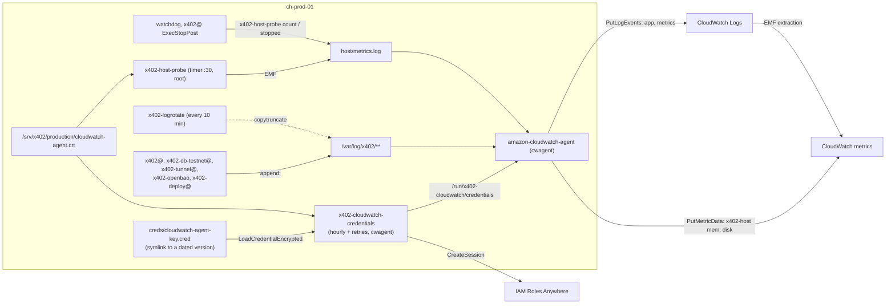

# PR #113 architecture spine: the server side

The consistency contract for #113: the units that write logs, the CloudWatch agent and its
credentials, the host probe, the rotation and the playbook. It inherits #112's spine
([S-pr112-spine](S-pr112-spine.md)) and fixes only what two pieces of #113, or #113 and #114,
could otherwise choose incompatibly. Metrics are in [G-metrics](G-metrics.md), alarms in
[G-alarm-list](G-alarm-list.md), the evidence in [R-log-path-spike](R-log-path-spike.md).

## Paradigm: files as the only seam, one shipper

Every producer on the server (the units' Compose processes, the host probe, the watchdog, a unit's
stop hook) appends lines to a file under `/var/log/x402/`. The CloudWatch agent is the only reader
of those files, the only process that talks to AWS, and the only holder of AWS credentials. No
producer knows about AWS, and no producer is ordered after the agent or its credentials, so an AWS
or agent outage can't stop a container. The files' table (AD-2) is the contract between producers,
the agent config, the rotation and the playbook.

## Inherited invariants

| Inherited | From | Binds here |
| --- | --- | --- |
| AD-1 | S-pr112-spine | The probe can't import TypeScript: a test runs it with fakes and checks every name, unit, namespace and dimension against `@stellar-x402/metrics-catalog` |
| AD-2 | S-pr112-spine | A host series has exactly the catalog's dimension set; #113 closes `disk_used_percent`'s open `path` to `values: { path: ["/"] }` (hand-off to #112) |
| AD-4 | S-pr112-spine | Every EMF line starts with `EMF_LINE_PREFIX`; the agent's split uses that constant |
| AD-6 | S-pr112-spine | `host` goes on only once `make check-series GROUP=host` sees every series it reads |
| Hand-off | S-pr112-spine | Host metrics go to `x402-host` with the catalog's dimensions, never `CWAgent` |
| Decision 24 | 0027 README | Groups `/x402/<env>/app` and `/x402/<env>/metrics`; role `x402-<env>-logging` |
| Decision 25 | 0027 README | The trust policy accepts only `CN=x402-cloudwatch-agent-production` |
| Decision 26 | 0027 README | A group is absent or on with its actions; `facilitator` and `host` go on with #113 |
| Decision 30 | 0027 README | The role can't create groups or set retention; sessions up to 12 h |

## Invariants and rules

### AD-1: the agent is the only AWS client on the server

- **Binds:** the units, the probe, the watchdog, the helper, the agent, the playbook.
- **Prevents:** a second process holding AWS credentials, and a container that waits on AWS.
- **Rule:**
  - Producers only append to files. None calls AWS, none reads the credentials file.
  - The credentials file is readable only by `cwagent` (and root).
  - No producer unit has `Requires=`, `After=` or `PartOf=` on the agent or the helper. The
    agent's drop-in orders it only after the helper (`Wants=`,
    `After=x402-cloudwatch-credentials.service`). 0038 may add an `ExecStartPre=` (Deferred),
    never an ordering on a producer and never an `Environment=` (the region is in the JSON, AD-8).
  - The agent starts without a credentials file and picks it up later.

### AD-2: one table of files, streams and filters

- **Binds:** the units' `StandardOutput=`, the agent's `collect_list`, the rotation's glob, the
  playbook's directories, the probe's output path, the runbook.
- **Prevents:** a unit writing a file the agent doesn't read or the rotation misses, a directory
  the playbook doesn't create, a (group, stream) pair reused across entries, an EMF line routed to
  the app group, a symlink rotated or read twice.
- **Rule:** the table below is complete. A file not in it isn't shipped; a new unit adds a row.
  The test keeps the table as data, the one copy code reads, and fails unless:
  - every `append:` path in `deploy/systemd/` (with `%i` as `production`) and every `file_path`
    in the agent config is a row;
  - every `log_group_name` is one of decision 24's two groups, with the EMF rows in metrics only;
  - no (group, stream) pair repeats, and no two `file_path`s map to one agent state-file name
    (`/` becomes `_`);
  - every row's directory is in the playbook's directory list, `emf/facilitator.log` is the
    playbook's symlink to `../facilitator.log`, and the probe's default output is
    `host/metrics.log`;
  - every row but the symlink matches exactly one glob of AD-10, and no glob matches `emf/`.

| File | Written by | Group | Stream | Filter | Event start |
| --- | --- | --- | --- | --- | --- |
| `<env>/facilitator.log` | `x402@` stdout | `/x402/<env>/app` | `facilitator` | exclude EMF | every line (`^`) |
| `<env>/emf/facilitator.log` (symlink to `../facilitator.log`) | same file | `/x402/<env>/metrics` | `facilitator` | include EMF | every line (`^`) |
| `<env>/facilitator.err.log` | `x402@` stderr | `/x402/<env>/app` | `facilitator-stderr` | none | default |
| `<env>/postgres-testnet.log` | `x402-db-testnet@`, both streams | `/x402/<env>/app` | `postgres-testnet` | none | default |
| `<env>/cloudflared.log` | `x402-tunnel@`, both streams | `/x402/<env>/app` | `cloudflared` | none | default |
| `<env>/deploy.log` | `x402-deploy@` and the runbook's hand-run `x402-migrate`, both streams | `/x402/<env>/app` | `deploy` | none | default |
| `openbao/openbao.log` | `x402-openbao`, both streams | `/x402/<env>/app` | `openbao` | none | default |
| `host/metrics.log` | the probe, the watchdog, `x402@`'s stop hook | `/x402/<env>/metrics` | `host` | include EMF | every line (`^`) |

Paths are under `/var/log/x402/`; `<env>` is `production`.

### AD-3: the EMF split

- **Binds:** the agent config, its test, the facilitator's writer (#112).
- **Prevents:** an EMF line lost to a joined event, metrics in the app group, a drop-oldest sender
  shared with app lines.
- **Rule:**
  - The filter expression is `^` plus `EMF_LINE_PREFIX` escaped for RE2 (`^\{"_aws":`); the test
    builds it from the constant, never retypes it.
  - Every entry that can carry an EMF line sets `multi_line_start_pattern` to `^`, the app entry
    of the same file included, so Compose's `\r\x1b[K... exited` line never joins an EMF line.
    Other entries keep the default, so a stack trace stays one event.
  - Each row of AD-2 has its own stream: the agent's first EMF-looking line switches a whole
    sender to drop-oldest.
  - Never set `timestamp_format`, `retention_in_days`, `log_group_class` or `auto_removal`.

### AD-4: host metric identity

- **Binds:** the agent's `metrics` section, the probe, the catalog (#112), the host alarms (#114).
- **Prevents:** an extra dimension (`host`, `device`, `fstype`, `mode`, `InstanceId`) making a
  series #114's alarms never read, and an agent config that drifts from the catalog unseen.
- **Rule:**
  - The agent publishes exactly `mem_used_percent` (no dimension) and `disk_used_percent`
    (`path="/"`) to `x402-host`: `agent.omit_hostname: true` (an `agent` key),
    `resources: ["/"]`, `aggregation_dimensions: [["path"]]`,
    `drop_original_metrics: ["disk_used_percent"]`. No `drop_device` (the rollup needs an
    original with more dimensions than `path`), no `append_dimensions`, no CPU, 60 s interval.
  - The probe writes every other `x402-host` gauge in the catalog, and the counters through
    AD-5. Two new entries come first in #112: `facilitator_failures_total` (counter, `Count`)
    and `credentials_age_seconds` (gauge, `Seconds`), both process-scoped, no dimension.
  - The probe test fails when the set of names the probe writes differs from the catalog's
    `x402-host` names minus the agent's two.
  - A test reads `deploy/cloudwatch-agent/config.json` and fails unless its namespace is the
    catalog's `x402-host`, its measurements yield exactly `mem_used_percent` and
    `disk_used_percent`, `aggregation_dimensions` equals the catalog's sets for
    `disk_used_percent`, `resources` equals that entry's `values.path`, `omit_hostname` is true,
    and it has no `cpu` section and no `append_dimensions`.

### AD-5: one emitter for host lines

- **Binds:** the probe, the watchdog, `x402@`'s `ExecStopPost`.
- **Prevents:** three hand-written EMF formats and unit tables drifting apart, a counter name
  misspelt at a call site, a heartbeat that hides a stopped probe, a startup failure uncounted.
- **Rule:**
  - `deploy/libexec/x402-host-probe` holds the only line format and the only name-to-unit table.
    Modes: no argument runs every check; `count <counter>` appends one line with value 1;
    `stopped` counts `facilitator_failures_total` unless `SERVICE_RESULT` is `success`, with
    `SERVICE_RESULT`, `${EXIT_CODE:-}` and `${EXIT_STATUS:-}` as log fields, empty when unset
    (systemd 255 sets neither when no main process ran: a failed `ExecStartPre`, a start
    timeout). A test runs `stopped` with neither variable set.
  - `stopped` counts every end that isn't `success`: a crash, a failed start, a drain cut by
    `TimeoutStopSec`, a `dockerd` crash, and a watchdog kill of a hung process, which also counts
    `watchdog_restarts_total`.
  - The line is #112's builder's shape: `_aws` first, `Dimensions: [[]]`, one metric per line,
    integer values, `Timestamp` in ms. One `printf` per line, appended with `>>`. Nothing goes to
    stdout in any mode; in `count` and `stopped` stderr is the caller's.
  - One timestamp per run, taken at its start. Only the no-argument mode writes
    `host_probe_heartbeat`, as its last line; `count` and `stopped` write one line each.
  - The watchdog calls `count watchdog_restarts_total || true` after its `docker stop`. `x402@`
    has `ExecStopPost=-/usr/local/libexec/x402/x402-host-probe stopped`. A test reads every
    `x402-host-probe count <name>` in `deploy/` and fails unless `<name>` is an `x402-host`
    counter in the catalog.
  - `x402-host-probe.service` runs as root (docker, the socket's 0750 volume directory).
    `x402-host-probe.timer` is `OnCalendar=*:*:30`, `AccuracySec=1s`, clear of the EMF flush at
    :00 and the rotation at :20.

### AD-6: a failed check reads past its threshold

- **Binds:** the probe, #114's host alarms.
- **Prevents:** a broken check that reads healthy (decision 10), and one check taking the others
  down.
- **Rule:**
  - On any failure: ages `1000000000`; `certificate_days_left` `-1`; `openbao_up` `0`;
    `wal_failing` `1`. A missing input (no stamp, no certificate, no or an empty credentials
    file) is a failure.
  - `set -u`, never `set -e`. Each check has its own timeout (at most 30 s together); the unit
    has `TimeoutStartSec=50`. Exit 1 only when a line couldn't be appended.
  - Diagnostics go to stderr: the journal in the probe's own unit, which has no
    `StandardOutput=append:`, and `facilitator.err.log` under `x402@`'s stop hook (AD-5).
- **Checks:**
  - `openbao_up`: `curl` through testnet's socket on the host,
    `<DockerRootDir>/volumes/x402-openbao-testnet/_data/bao.sock` (the root read once per run
    with `docker info --format '{{.DockerRootDir}}'` under `timeout`, as the playbook does),
    `GET /v1/sys/health`; 200 is 1, anything else 0.
  - `wal_failing`, `wal_last_archived_age_seconds`: `docker exec` into the running
    `postgres-testnet` found by its Compose labels, one `pg_stat_archiver` query. `wal_failing`
    is 1 when `last_failed_time > last_archived_time`, when `last_archived_time` is null (nothing
    archived yet, today's state, and after an unclean shutdown, which resets `pg_stat_archiver`
    on PostgreSQL 15+), or when the check fails; otherwise 0. The age is now minus
    `last_archived_time`, and `1000000000` when that is null.
  - `backup_age_seconds`, `snapshot_age_seconds`: the mtime of
    `/var/lib/x402/last-ok/{pgbackrest-backup,openbao-snapshot}` (AD-7).
  - `certificate_days_left`: the floor of the days to `notAfter` of AD-13's certificate path,
    negative after expiry.
  - `credentials_age_seconds`: since the mtime of `/run/x402-cloudwatch/credentials`; an empty
    file is a failure (a `stat`, never a read: AD-1).
  - Every path above has an environment variable that overrides it, for the test and a fire
    drill (#115) only.

### AD-7: the stamp contract with 0026

- **Binds:** the probe, 0026's pgBackRest and OpenBao snapshot jobs, the runbook, ADR 0011's
  "Logs, metrics and alerts".
- **Prevents:** the probe learning each job's internals, a reboot reading as a missed job, and a
  contract only the code knows.
- **Rule:**
  - A job touches its stamp only after it succeeded, as root whatever its `User=`
    (`ExecStartPost=+/usr/bin/touch ...`). The stamp's mtime is the time of the last good run;
    a job may set it from its repository (`touch -d @<epoch>`). Stamps live on disk in
    `/var/lib/x402/last-ok/` (AD-14), never in `/run`.
  - ADR 0011 and the runbook state the contract: the paths, what the mtime means, touched only
    after success, never in `/run`. Stan confirms it in #113's review, and 0026's job units cite
    it.

### AD-8: the credentials chain

- **Binds:** the helper's units, the agent's `common-config.toml`, JSON and drop-in, the playbook,
  the runbook, #114's Telemetry stack.
- **Prevents:** expired keys in use, a decrypted key left on disk, a dual-stack endpoint that the
  role's `aws:SourceIp` refuses, an agent that can't translate its config at start, credentials
  removed after each run, 1 h sessions, an hour without credentials after a reboot.
- **Rule:**
  - `x402-cloudwatch-credentials.service`: a oneshot with `User=cwagent`, `Wants=` and
    `After=network-online.target`, `TimeoutStartSec=60`, `Restart=on-failure`, `RestartSec=60s`.
    It runs `/usr/local/bin/aws_signing_helper update --once --session-duration 43200 --profile
    AmazonCloudWatchAgent` (the default session is 3600 s) with AD-13's certificate, the key, the
    ARNs and the endpoint below. The agent's `Wants=` starts it at boot, and
    `x402-cloudwatch-credentials.timer` (`OnCalendar=hourly`, `AccuracySec=1s`) every hour.
  - The key reaches it only through
    `LoadCredentialEncrypted=cloudwatch-agent-key:/srv/x402/production/creds/cloudwatch-agent-key.cred`
    (`x402-creds` decrypts only for root-run containers).
  - `AWS_SHARED_CREDENTIALS_FILE=/run/x402-cloudwatch/credentials`, profile
    `AmazonCloudWatchAgent`, in `RuntimeDirectory=x402-cloudwatch` with
    `RuntimeDirectoryMode=0700` and `RuntimeDirectoryPreserve=yes`, exactly: `restart` or the
    default removes the directory after every run. No `RemainAfterExit=`: the hourly start would
    do nothing.
  - `common-config.toml` names the same file and profile. It is the package's conffile at
    `/opt/aws/amazon-cloudwatch-agent/etc/common-config.toml`, the only path the start wrapper and
    ctl read; `apt`'s `force-confold` keeps it across upgrades. The playbook writes it without
    `owner` or `group`, since the wrapper re-owns `etc/` to `cwagent` at every start.
  - The agent JSON sets `agent.region` to `eu-central-1` (#114's `awsRegion`); a test fails
    without it. The start wrapper translates the config again at every start, with `--mode auto`
    and the unit's environment, so `AWS_REGION` serves only ctl's `fetch-config` (AD-11).
  - The agent runs as `cwagent` through `agent.run_as_user`, never a `User=` in its unit.
  - Endpoints are the standard regional ones: the helper gets
    `--endpoint https://rolesanywhere.eu-central-1.amazonaws.com`, the agent
    `use_dualstack_endpoint: false` and no `endpoint_override`. A test fails on `api.aws`,
    `dualstack` set true or `endpoint_override` anywhere in `deploy/`.
  - The trust anchor and profile ARNs come from the git-ignored `inventory.ini` (they end in a
    UUID); the role ARN is built from their account and the fixed name `x402-<env>-logging`
    (decision 24). The playbook templates the three into `/etc/x402/cloudwatch-credentials.env`
    (`TRUST_ANCHOR_ARN`, `PROFILE_ARN`, `ROLE_ARN`), which the unit reads with
    `EnvironmentFile=`; no unit file is templated.
  - A test reads the helper's units for `--once`, `--session-duration 43200`, the profile, the
    network ordering, `RuntimeDirectoryPreserve=yes` and no `RemainAfterExit=`.

### AD-9: unit output and its failure modes

- **Binds:** the five units, `x402-deploy`, the playbook, the runbook.
- **Prevents:** a full disk stopping a unit or a rollback, Compose decorations in raw lines, and a
  reloaded unit that fails on a directory that isn't there yet.
- **Rule:**
  - Every `docker compose up` runs with `--no-log-prefix --no-color`.
  - Only `x402@` splits stdout and stderr; the others have `StandardError=inherit`.
  - No `ExecStartPre` or `ExecStartPost` prints on success; the wait loops of
    `x402-db-testnet@` and `x402-openbao` send `exec`'s output to `/dev/null`.
  - A script whose output goes to these files never dies on a failed write: `x402-deploy`
    prints through `say() { printf '%s\n' "$*" || :; }`.
  - AD-2's directories and symlink exist before any unit file that names them is on disk, not
    just before a start: after a reload, a running unit's next `ExecStop` or `ExecStopPost`
    opens its new `append:` files, and a missing directory fails with 209/STDOUT (AD-11's
    order).
  - Every oneshot a timer starts has a `TimeoutStartSec`, the watchdog's included.

### AD-10: rotation

- **Binds:** `deploy/logrotate/x402-logs.conf`, the rotation's units, the playbook's directories,
  AD-2's files.
- **Prevents:** the daily `logrotate.timer` rotating our files with other settings, a lost
  offset, a refused rotation.
- **Rule:**
  - `deploy/logrotate/x402-logs.conf`, installed as `/etc/x402/logrotate.conf` (root, 0644),
    with its own state in `/var/lib/x402-logrotate/`. AD-2's files are never in
    `/etc/logrotate.d`; OpenBao's audit log keeps its daily rule in
    `/etc/logrotate.d/x402-openbao`. `x402-logrotate.timer` at `*:00/10:20`, `AccuracySec=1s`.
  - `copytruncate`, `size 100M`, `rotate 10`, `compress`, `delaycompress`, `missingok`,
    `notifempty`. Its globs are `/var/log/x402/<env>/*.log`, `openbao/*.log`, `host/*.log` and
    never reach `emf/`.
  - The directories are `root:cwagent` 2750 with setgid and never group-writable, so logrotate
    needs no `su` and the agent reads every new file.
  - It accepts ADR 0011's two `copytruncate` losses, both kept in the rotated file: up to 250 ms
    of unread lines per rotation, and during an AWS outage every app line since the agent
    blocked.

### AD-11: the playbook's boundary

- **Binds:** `deploy/ansible/playbook.yaml`, the runbook.
- **Prevents:** an unpinned binary on the server, a run that restarts a producer, a unit copied
  before its directory, a config change that never reaches the agent, a red `--check`.
- **Rule:**
  - The agent and the helper are fetched with `get_url` from their versioned URLs (Stack), never
    `/latest/`, with the pinned SHA-256; the `.deb` is installed with `apt deb:`,
    `allow_downgrade: true`. `apt` also installs what the probe and the rotation call (`curl`,
    `openssl`, `logrotate`, and `jq` if the probe uses it), though the server has them today.
  - Order within a run: the downloads and the `.deb`, which creates `cwagent`; then AD-14's
    directories, files and symlink; then `libexec/`; then `systemd/` and the reload. A failed
    step stops the run before any unit is copied. A task that needs `cwagent` or a downloaded
    file has `when: not (ansible_check_mode and agent_deb is changed)`, so `--check` before the
    first install stays green.
  - The agent JSON is copied to `/etc/x402/cloudwatch-agent.json` and applied with
    `amazon-cloudwatch-agent-ctl -a fetch-config -m onPremise -c file:/etc/x402/cloudwatch-agent.json`
    (with `AWS_REGION`, no `-s`) only when it differs from the agent's copy.
  - A run that changed the agent JSON or `common-config.toml` restarts `amazon-cloudwatch-agent`
    once, when it is active, after the `.deb` and both files are in place (a handler). Otherwise
    the agent restarts only on an upgrade, through the package's scripts. The agent's restart
    never touches a container (AD-1); no run restarts a producer unit.
  - It enables `amazon-cloudwatch-agent.service` and four timers: the watchdog's, as today,
    `x402-host-probe.timer`, `x402-logrotate.timer` and `x402-cloudwatch-credentials.timer`. The
    helper's, the probe's and the rotation's services have no `[Install]` and aren't enabled. It
    starts only the first three timers; the agent and the helper's timer start in AD-12's admin
    step. A reboot before it starts them too: the helper then fails each run, the probe writes
    `certificate_days_left` -1 and `credentials_age_seconds` 1000000000, and `host` stays off.
  - The certificate is copied only once it is committed (`deploy/ansible/files/`) and passes
    AD-13's checks. The ARNs are asserted before any change.
  - An agent version bump in Stack re-runs the spike's CBOR stub case (AD-4) before it merges.
  - It never touches the server's base setup (`daemon.json`, firewall, users other than its own).

### AD-12: rollout and the restart window

- **Binds:** the playbook, the runbook's admin step, the five units, #114's Telemetry stack and
  `uptime`.
- **Prevents:** an agent started before its role and groups exist, step 1's deploy breaking on
  files the playbook hasn't installed, units writing files before the agent ships them, three
  units left in the journal for months, and a restart window that pages `uptime` unannounced.
- **Rule:**
  - First: `/x402/production/server-ip` holds the server's IPv4, then #114's Telemetry stack
    (groups, anchor, profile, role) is deployed and its ARNs go into `inventory.ini`.
  - Then the runbook's order for a change under `deploy/` (0091): the merge to
    `deploy/production`, whose deploy runs on the old files; the playbook from that merge, once
    that workflow run has ended; the admin step; the restart window; the checks. Every #113 file
    works with the old units and scripts until the window.
  - Admin step, as `deploy` with sudo (akot): the certificate in place and checked (AD-13; if it
    wasn't committed with the merge, the playbook runs again once it is); start
    `x402-cloudwatch-credentials.service`, then its timer and `amazon-cloudwatch-agent`; check
    that `credentials_age_seconds` is under 60 and the `host` stream arrives in the metrics
    group. Only then the window.
  - The window, the brief's order (akot, 5.11): `stop x402@production` (a drain, up to 180 s);
    `restart x402-openbao` (auto-unseal, while the facilitator is stopped, so `/settle` stops
    once); `restart x402-db-testnet@production`; `restart x402-tunnel@production`;
    `start x402@production`. The runbook's step 3 is rewritten to it. `x402-deploy@` takes its new
    unit at the next deploy.
  - Checks: `/health` `ready`; the files of AD-2 exist and grow (`deploy.log` at the next deploy,
    `facilitator.err.log` only when something writes stderr); their streams arrive in both groups.
  - Budget: under 7 minutes, `uptime`'s threshold. Typically 30-60 s; with every cap hit about
    8.3 minutes, so the window runs while `/settle` is idle, when the drain ends in seconds, and
    if the timing allows before `uptime`'s group goes on (off in #114's `envs/production.json`
    today; akot, 5.11). Once decision 37 has turned it on, a post in the channel comes first, and
    a page past 7 minutes stands (decision 26).
  - The Telemetry deploy, each playbook run, the admin step and the window are each done with the
    user's consent, one at a time.

### AD-13: the certificate and its renewal

- **Binds:** the CSR, the committed certificate, the playbook, the helper's unit, the probe, the
  runbook, #114's trust policy and `certificate` alarm.
- **Prevents:** a certificate the trust policy refuses, or one that doesn't match the key, reading
  healthy to `certificate`; the helper and the probe watching different files; a renewal that
  leaves the key and the certificate out of step until the sessions run out.
- **Rule:**
  - Identity: subject CN `x402-cloudwatch-agent-production` (decision 25, #114's
    `logging.certificateCn`), `CA:FALSE`, key usage `digitalSignature`, extended key usage
    `clientAuth`. The CSR is made on the server from the key, since the explorer's
    `issue-client-cert.sh` makes its own key; the CA holder signs it for 365 days.
  - One path: committed as `deploy/ansible/files/cloudwatch-agent-production.crt`, installed as
    `/srv/x402/production/cloudwatch-agent.crt` (root, 0644). The helper's `--certificate` and the
    probe's default are that path; a test checks that both name it.
  - A test checks the committed file's CN and extensions and that it hasn't expired. The playbook
    asserts the same, and that its public key equals the key's (`systemd-creds decrypt` into a
    pipe to `openssl pkey -pubout`, only the public key printed, `no_log`), before it copies it.
  - Key versions, as `x402-creds`' versioned credentials: `creds/cloudwatch-agent-key.<date>.cred`
    (`date +%F`), encrypted with `--name=cloudwatch-agent-key`; `cloudwatch-agent-key.cred` is a
    symlink to the active one, so `LoadCredentialEncrypted=` never changes. Today's key becomes
    its first version at the first renewal, renamed, not regenerated.
  - Renewal, yearly, from the `certificate` alarm at 30 days: a new key and CSR on the server,
    same subject and extensions; the CA holder reissues the CN (`--force`); the certificate goes
    through a pull request to `deploy/production`. Then, in one sitting once its deploy has
    ended: move the symlink to the new key, run the playbook (its match check now passes and it
    copies the certificate), start `x402-cloudwatch-credentials.service`, and check that
    `credentials_age_seconds` is under 60. Key first, certificate second, since the playbook
    refuses a certificate that doesn't match the active key. The old key's version stays until
    that start succeeds; moving the symlink back undoes it, and the 12 h sessions cover the
    sitting.

### AD-14: one creator per path

- **Binds:** the playbook, every unit, 0026's job units, the agent's package.
- **Prevents:** a unit's `LogsDirectory=` or `StateDirectory=` re-owning a tree another writer
  shares, a stamp a non-root job can't touch, and two creators of one path with different modes.
- **Rule:**
  - The playbook creates `/var/log/x402/` and each directory of AD-2 (`root:cwagent` 2750, setgid,
    AD-10), each row's file (`root:cwagent` 0640) and the `emf/facilitator.log` symlink
    (`force`). A file systemd recreates at `append:` is 0644 `root:cwagent`, still behind 2750.
  - The playbook creates `/var/lib/x402/last-ok/` (`root:root` 0755); jobs touch their stamps as
    root (AD-7). It creates `/etc/x402/` (root, 0755, holding the agent JSON, `logrotate.conf` and
    `cloudwatch-credentials.env`) and `/var/lib/x402-logrotate/`.
  - systemd creates `/run/x402-cloudwatch/` (the helper's `RuntimeDirectory=`, AD-8), the only
    `*Directory=` setting in #113.
  - The package owns `/opt/aws/amazon-cloudwatch-agent/` and the user `cwagent`; the playbook
    writes only `etc/common-config.toml` there (AD-8).
  - No unit sets `LogsDirectory=` or `StateDirectory=` on a path under `/var/log/x402` or
    `/var/lib/x402`, and none sets `UMask=` (the 2750 directories protect the files; `UMask`
    would also change `digest*`'s modes).

### AD-15: what the runbook and ADR 0011 say

- **Binds:** `docs/runbook.md`, ADR 0011's "Logs, metrics and alerts", AD-2, AD-7, AD-12, AD-13.
- **Prevents:** a runbook step that reads an empty journal after the move, a cut-over or renewal
  done from memory, and a stamp contract only the code knows.
- **Rule:** the runbook says:
  - where the logs are: AD-2's files, groups and streams, and the rotated files (`*.log.1`,
    `*.gz`) that keep the app lines a rotation lost during an AWS outage;
  - a unit's output is read from its file (`tail -F /var/log/x402/production/deploy.log` in place
    of `journalctl -fu x402-deploy@production`), and `journalctl -u` only for its own start and
    stop lines; the watchdog, the probe, the helper and the agent stay in the journal;
  - "Longer than the cap"'s `systemd-run --unit=x402-migrate` gets
    `-p StandardOutput=append:/var/log/x402/production/deploy.log -p StandardError=inherit`, so a
    hand-run migration's history ships like the deploy's (decision 1; akot, 5.11);
  - the CSR as it was made, the signing, the commit, and the renewal (AD-13), which the
    `certificate` alarm's `next` names;
  - the admin step and the restart window (AD-12), replacing step 3's order;
  - the stamp contract (AD-7);
  - reading `facilitator-failed` (the `SERVICE_RESULT` and `EXIT_STATUS` fields in
    `host/metrics.log`) beside `watchdog-restart`, and `credentials-stale` (the helper's journal).

  ADR 0011's section states the stamp contract and where the logs are now. The 0027 README
  records this spine's choices as decisions 42-54.

## Consistency conventions

| Concern | Convention |
| --- | --- |
| Unit names | `x402-<thing>[@<env>]`; the agent keeps the package's `amazon-cloudwatch-agent.service`, changed only by `amazon-cloudwatch-agent.service.d/x402.conf` |
| Repo layout | config under `deploy/cloudwatch-agent/` (`config.json`, `common-config.toml`) and `deploy/logrotate/`, scripts in `deploy/libexec/`, units and drop-ins in `deploy/systemd/` (the playbook copies both directories whole), the certificate in `deploy/ansible/files/` |
| State | credentials in `/run/x402-cloudwatch/`; stamps in `/var/lib/x402/last-ok/`; rotation state in `/var/lib/x402-logrotate/`; config in `/etc/x402/`, except `common-config.toml` at the package's path (AD-8) |
| Credentials | containers' credentials stay with `x402-creds` (decrypted to `/run/x402/<env>/`); a host process run as a non-root user gets its key only through `LoadCredentialEncrypted=`; a versioned credential is `<name>.<date>.cred` behind the `<name>.cred` symlink |
| Binaries | the helper at `/usr/local/bin/aws_signing_helper` (root, 0755), the one path its unit and `get_url` share; scripts in `/usr/local/libexec/x402/` |
| Line format | EMF exactly as #112's builder writes it; app lines untouched |
| Scripts | POSIX `sh` (dash), `set -u`, `${VAR:-}` for any variable systemd may leave unset, every `docker`/`curl`/`openssl` call under `timeout`, stdin from `/dev/null` for `docker exec` |
| Tests | the `@stellar-x402/deploy` workspace package (listed in `pnpm-workspace.yaml` after `- conformance`, so CI runs it), `deploy/test/*.test.ts`, vitest; run the real scripts with fakes first on `PATH`, spawned asynchronously; Linux only |

## Stack

| Name | Version |
| --- | --- |
| Ubuntu (server) | 24.04.3, kernel 6.8 |
| systemd (server) | 255 (`255.4-1ubuntu8.18`; the source read is upstream v255) |
| Docker CE / Compose plugin / containerd | 29.5.1 / 5.1.3 / 2.2.3 |
| amazon-cloudwatch-agent | 1.300074.1b2005 from `https://amazoncloudwatch-agent.s3.amazonaws.com/ubuntu/amd64/1.300074.1b2005/amazon-cloudwatch-agent.deb`, sha256 `3477032345ce3b325ed21269505f992813ee0508aafc516feb2eaf00f58270de`, GPG key `937616F3450B7D806CBD9725D58167303B789C72`; GitHub's "latest release" still shows v1.300074.0, the same code |
| aws_signing_helper | 1.8.6 from the versioned path `releases/1.8.6/X86_64/Linux/Amzn2023/aws_signing_helper` the AWS docs give, sha256 `3553fdc515e5682541a9ebdd37031ec7f461169aa13ccbb6fbd5b7259644113d`, read from the docs' table (Roles Anywhere user guide, "credential helper") on 2026-11-05; the table lists only the current version, and the Linux binary is unsigned |
| logrotate (server) | 3.21.0 |
| ansible-core (admin's machine) | 2.19 or later (the sources read; 2.22.0 diffed, no change to the modules used) |
| OpenBao | 2.7.2 (the pinned image) |
| PostgreSQL | 18 (the pinned image) |

## Structural seed



```text
deploy/
  package.json            # @stellar-x402/deploy: tests only
  test/                   # the files table as data, agent config, probe, units, endpoints, certificate
  cloudwatch-agent/config.json
  cloudwatch-agent/common-config.toml
  logrotate/x402-logs.conf
  libexec/x402-host-probe # the emitter (AD-5) and the checks (AD-6)
  systemd/                # changed units, new units and timers, the agent's drop-in
  ansible/files/cloudwatch-agent-production.crt
```

## Handed to the other PRs

- **#112:**
  - catalog entries `facilitator_failures_total` and `credentials_age_seconds`, and their
    G-metrics rows, before #113's probe test can pass;
  - `disk_used_percent` gets `values: { path: ["/"] }`, and the "stays open" comment goes.
- **#114:**
  - `facilitator-failed` (Event, `host`): any end of `x402@` other than `success`, so a crash, a
    failed start (each start of a crash loop), a drain cut by `TimeoutStopSec`, a `dockerd` crash,
    and a watchdog kill of a hung process, which fires `watchdog-restart` beside it. Its
    description says so and points at `EXIT_STATUS` in the line's fields.
  - `credentials-stale` (Level, above 7,500 s, `host`): two hourly runs plus 5 minutes, so one
    hour of failed runs and retries doesn't fire. Missing data keeps its state (decision 19),
    `probe-silent` covers its silence.
  - `telemetry-silent` fires when either series is silent: `MIN([FILL(mem,0), FILL(disk,0)]) < 1`,
    so a lost disk series fires.
  - `envs/production.json`: `host.diskMounts: ["/"]` (no `/boot`, whose filling blocks a kernel
    update, not the facilitator) and `host.auditDiskMount: "/"` (akot, 5.11): OpenBao's audit
    volume sits on `/`, so `audit-disk` and `disk` read one series, and `audit-disk`'s
    description says the disk is shared with ClickHouse and Postgres. Once the catalog closes
    `path`, synth checks both through `seriesDims`, so a mount the agent doesn't write fails.
  - `openbao-down`'s description: it sees OpenBao down or sealed; a sign that fails while
    OpenBao is up is `signer-failures`' (#112), and the probe holds no token to try one.
  - `wal-stale`'s description: a facilitator stopped for over 10 minutes writes no WAL.
    `wal-failing`'s: a Postgres crash reads as failing until the next segment is archived.
  - `memory`'s threshold is measured on `mem_used_percent`, which excludes page cache (about
    112 GB of ClickHouse's), not on `free`'s used.
  - `certificate`'s `next` names the runbook's renewal section (AD-13).
  - `alarmGroups.facilitator` and `alarmGroups.host` go on after #113's window, once
    `make check-series GROUP=facilitator` and `GROUP=host` pass (decision 26).
- **#115:** `docs/monitoring.md` fires each of #113's alarms once: `probe-silent` (the probe's
  timer stopped for 15 minutes), `telemetry-silent` (the agent stopped for 15 minutes),
  `watchdog-restart` (`x402-host-probe count watchdog_restarts_total`), `facilitator-failed`
  (`systemctl kill x402@production`, then its restart), `credentials-stale` (the helper's timer
  stopped for over 2 hours), `certificate` (through the probe's path override, AD-6).
- **0026:** `archive_timeout` of about 60 s; `pg_switch_wal()` once the database is ready after a
  start, so a crash doesn't read as `wal-failing` until the next segment; the jobs touch AD-7's
  stamps as root (`ExecStartPost=+`), citing the contract ADR 0011 states.
- **0038:** a compromised `cwagent` can write `run_as_user: root` into `etc/`, which the root
  wrapper honours at the next start; the drop-in's root-owned config (Deferred), after which
  `common-config.toml` gets an owner.

## Open until the spike (8a) or the first deploy

Each is a case in the Docker CE 29.5.1 VM unless marked. A failed case reopens its AD. The VM runs
the server's `daemon.json` as it is (`json-file` 100m×5, `live-restore`, `no-new-privileges`, the
address pool) and the server's pinned packages, from an image as minimal as the server's.

- AD-3: `^` on the real agent (an EMF line before the exit line keeps its metrics).
- AD-4: the translator's output and the `PutMetricData` body, through a stub that answers CBOR.
- AD-6: testnet's socket visible from the host at the volume's path; otherwise AD-6 reopens, and
  `bao status` through `exec` needs a check against OpenBao's 256 MB and for orphaned processes
  first. The WAL check's `docker exec` into `postgres-testnet` under 0091's `cap_drop` and the
  global `no-new-privileges`.
- AD-8: the agent started with `systemctl start`, never ctl `-s` from a shell with `AWS_REGION`,
  with no `AWS_REGION` in its environment, and again with `systemctl restart` after
  `fetch-config`; the agent starting before the credentials file exists; the helper's boot run
  and retry; the first real `CreateSession` (first deploy).
- AD-9: ENOSPC on a small loop filesystem, during the two `ExecStartPost` wait loops and during
  the migration's `docker compose run` (expected outcome written down first); dockerd restart,
  upgrade and crash under `live-restore`; `ExecStopPost` results for each way out, a failed
  `ExecStartPre` included.
- AD-9 and #112: `compose stop` puts the final flush in `facilitator.log` within the writer's 2 s
  bound, before Compose exits.
- AD-10: logrotate 3.21 from `x402-logrotate.timer` with its own state; an agent restart across a
  rotation; `facilitator.log` rotated during an outage, the new file growing past the old offset.
  If a garbled line fires `emf-parsing`, its description says so.
- AD-11: a first `--check` (with `python3-apt` absent, as `apt` installs it only outside
  `--check`), a real run, a second run with nothing changed, and a run with a changed agent JSON.
- First deploy: metrics extracted from both metric streams; how a `Values` array aggregates; the
  facilitator image under `init` and `no-new-privileges` on Docker CE; the 2 s bound on the real
  path; the standard endpoints still without AAAA records.
- Each first-deploy item, the first `CreateSession` and the playbook's first real run are done
  with the user's consent, each one separately.

## Deferred

- The `cwagent` to root path: the agent hands `etc/` to `cwagent` and its root wrapper translates
  it at the next start. A drop-in that restores a root-owned config first, before mainnet (0038).
- A `network` dimension for the WAL and backup metrics, when mainnet's database arrives.
- A second environment on the server: one agent and one helper serve it with `production`'s role,
  certificate and groups, and the per-server rows (`openbao/`, `host/`) stay in `production`'s
  groups. A second environment's rows need its groups on that role (#114), decided when it
  arrives.
- The watchdog's message in CloudWatch (it stays in the journal).
- A per-minute rotation, if real floods show 10 minutes is too slow.
- An external dead-man's switch, with 0038 (#112's spine).
